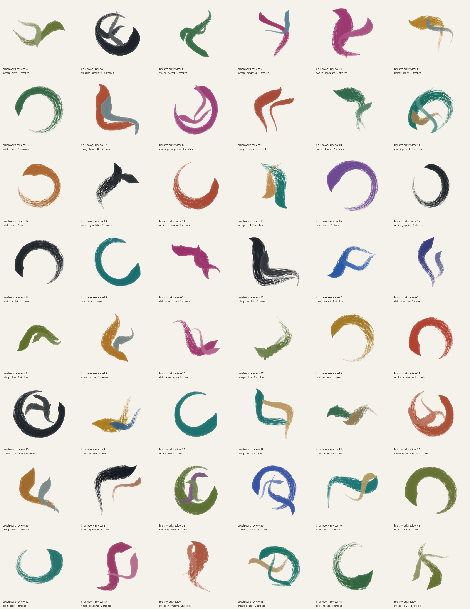
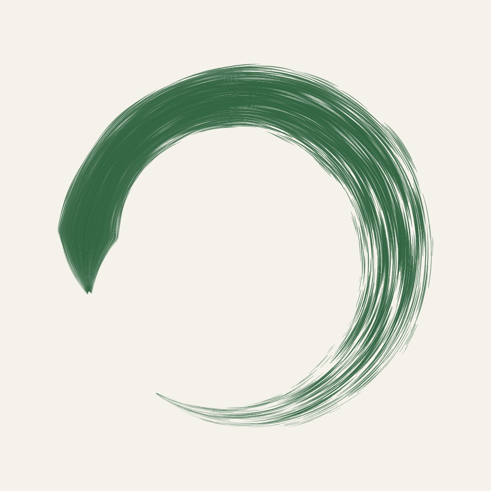
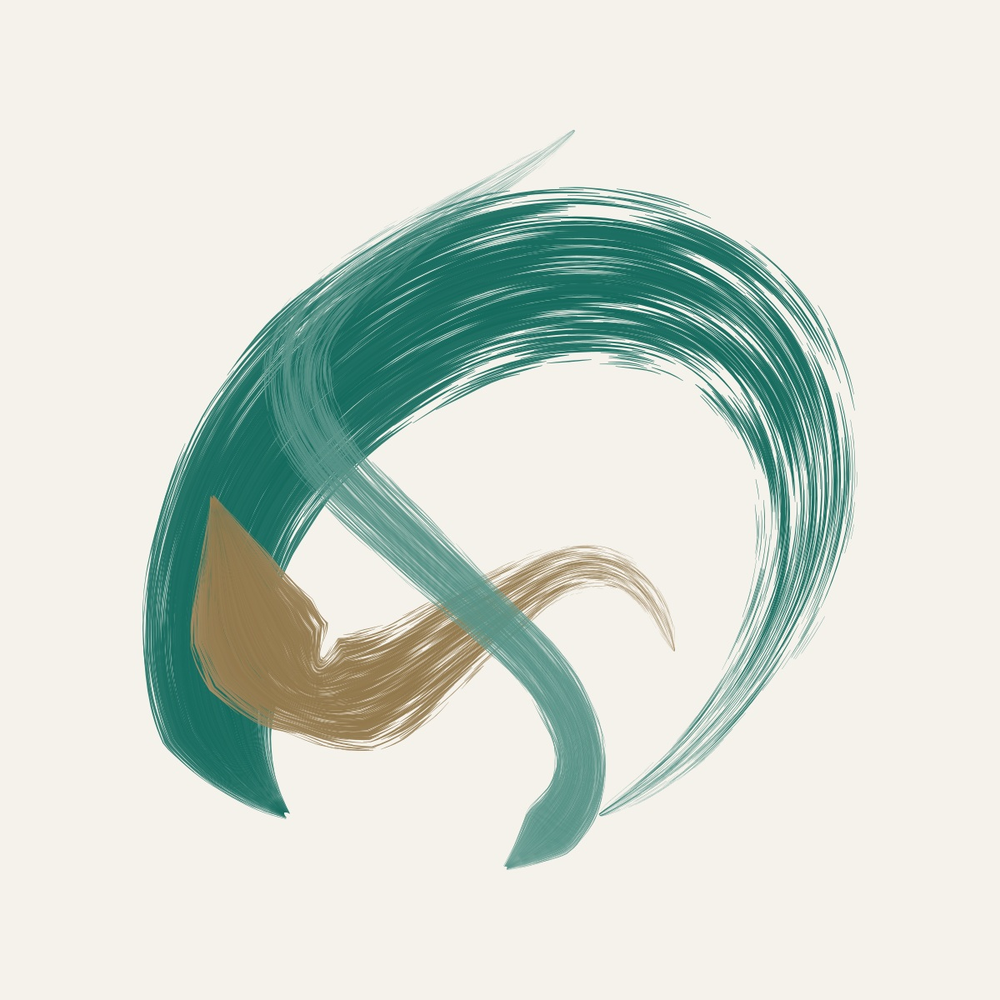
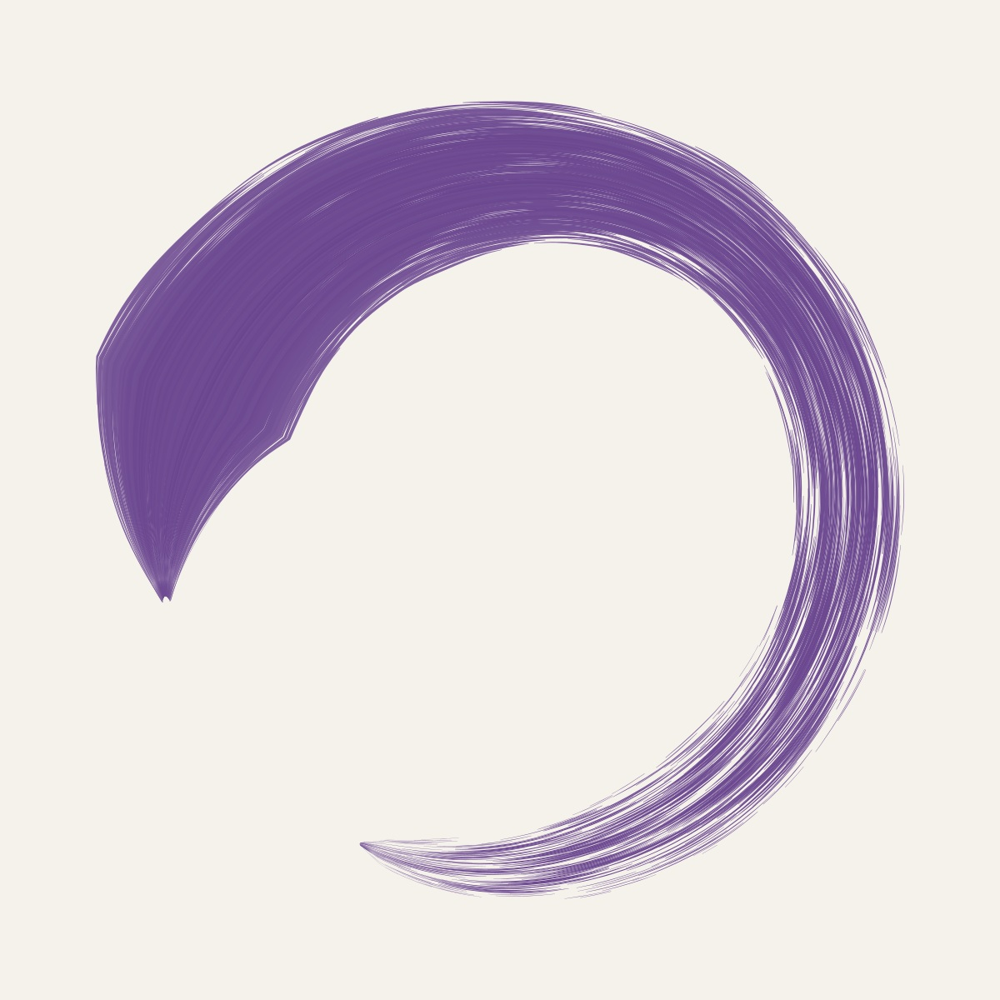
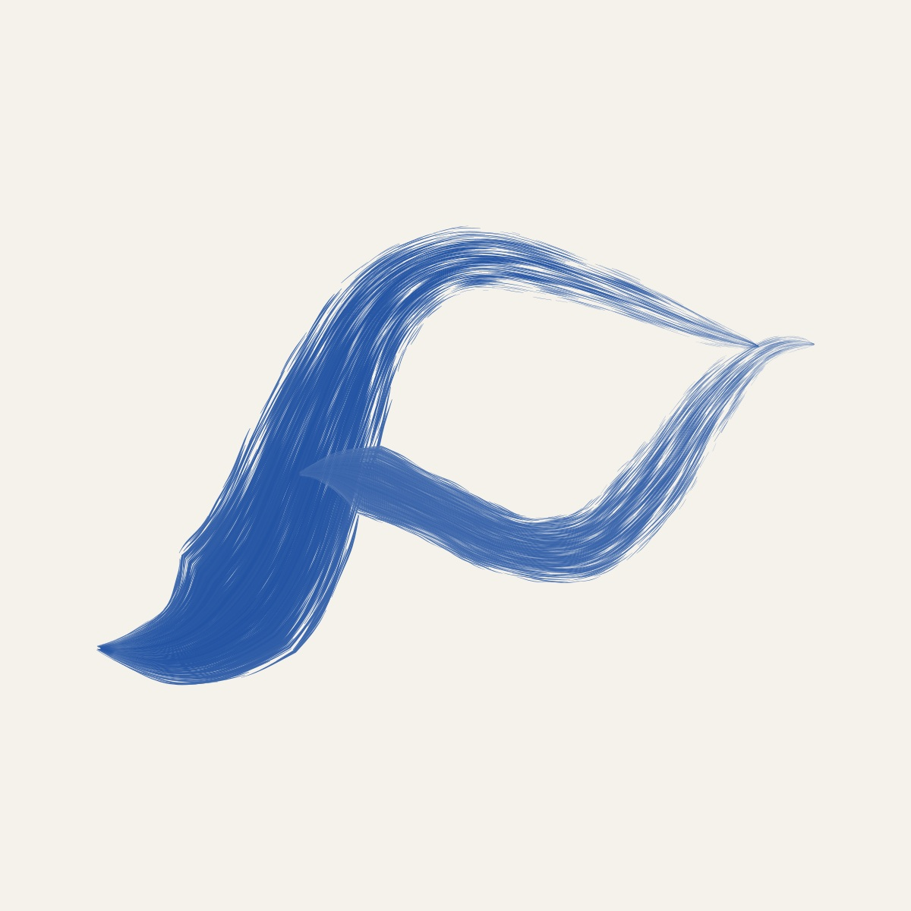
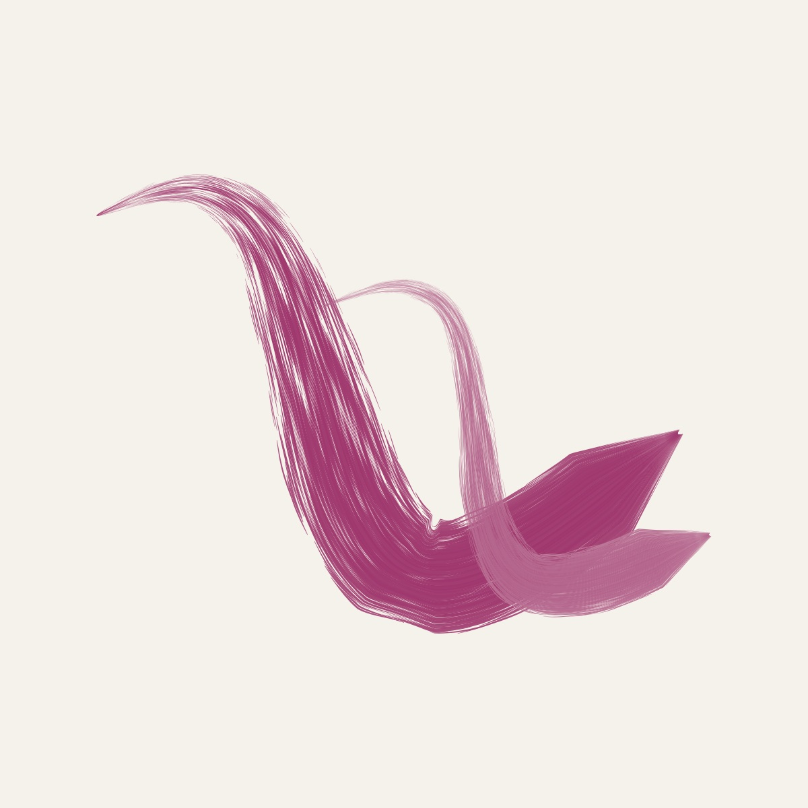
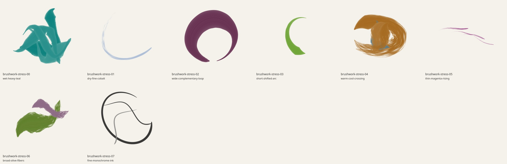
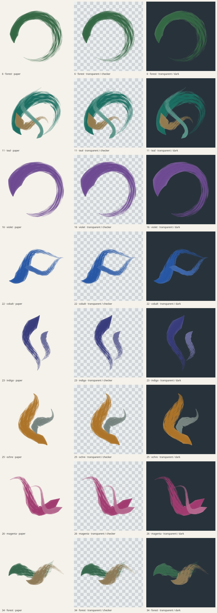

# Brushwork: color and texture review

Revision 2 adds ten seeded pigment palettes: graphite, indigo, cobalt, teal,
forest, violet, magenta, ochre, terracotta and olive. Small seeded hue and
saturation variations broaden each palette. Explicit color controls can change
the palette or rotate/desaturate it while preserving complete brush geometry.



The [48-seed report](previews/brushwork-report.json) records exact parameters,
SVG/PNG SHA-256, bounds, coverage, file size and timing. Every image is distinct,
all ten palettes appear, and none has ink in the outer two pixels. Colored area
covers 9.34–27.87% of the page. Local generation averaged 90.3 ms and peaked at
236.3 ms; SVGs averaged 485 KB and peaked at 901 KB. Timings exclude rasterization
and vary with machine and concurrent load.

All 48 seeds' fitted SVG path coordinates were compared directly with revision
1: **every path is unchanged**. The report stores a geometry hash for each
comparison. Only pigment colors and revision metadata changed.











I inspected the contact sheet and full-size colored examples. Saturated primary
strokes retain thin bristle gaps, lighter edge fibers and dry trailing ends.
Complementary counterstrokes remain distinct without changing stroke order or
intentional intersections.

## Joint extremes



The [stress report](previews/brushwork-stress-report.json) covers wet heavy teal
strokes, a pale dry cobalt loop, hue shifts at ±180°, saturation 0 and 1.4,
warm/cool crossings, thin rising marks and sparse/fine fibers. All eight SVGs
and PNGs are distinct, finite, nonempty and unclipped. Coverage spans
1.54–31.30%; the largest SVG is 3.01 MB. Local generation averaged 242.2 ms and
peaked at 700.9 ms.

The deliberately thin, low-pigment cobalt study is pale; the thinnest dry marks
become less legible at thumbnail size. These cases exercise supported limits
rather than the narrower default artistic priors.

## Paper and transparent exports



Eight examples were rendered at 1600×1600 through the app's actual Canvas
renderer in paper and transparent modes. The
[export report](previews/brushwork-export-report.json) records transparent,
opaque and antialiased pixel counts. All transparent margins are empty; paper
images are fully opaque. Recoloring preserves every alpha pixel, including fine
bristle texture. Compositing a transparent PNG onto the paper reference agrees
with the paper render within two RGB levels.

Transparent exports retain opaque pigment colors and expose the background
through real contact gaps; they do not simulate optical watercolor transmission.
Darker inks have lower contrast on dark backdrops, as shown. Texture remains
clear over paper and the light checkerboard.

## Model and tests

The [generator README](../src/generators/brushwork/README.md) documents palette
swatches, continuous color equations, the full parameter table, bristle model
and original *Hairy Brushes* research inspiration. Color selection has a
separate random stream and never perturbs trajectories or texture.

Nine targeted test groups pass: deterministic controls/validation; geometry
invariance across every palette and color extrema; analytic color cases and
bounded output; trajectory derivatives and exact circles; pressure/curvature
and width-slope limits; simplification error; contact loss and continuity;
48-seed diversity, all palettes and bounds; and joint extremes. Generator and
project both declare revision 2 so the shared cache upgrade retains old seeds.

The combined refinement also passes all 122 repository tests, the production
build and Chromium desktop/mobile/cache/export checks. See the
[shared integration evidence](refinement-review.md) for those results.

## Reproduce

```sh
node --test tests/brushwork.test.mjs
npm install --no-save --package-lock=false canvas@3.2.3 path2d@0.2.2
node scripts/art-review/brushwork.mjs --count 48 --raster --out /tmp/brushwork-review
node scripts/art-review/brushwork-stress.mjs --count 8 --prefix brushwork-stress --raster --out /tmp/brushwork-stress
node scripts/art-review/brushwork-exports.mjs --out /tmp/brushwork-exports
```

Omit `--raster` for SVG/report-only audits. `--overrides` accepts a JSON control
object, for example `'{"palette":"cobalt","hueShift":-4,"saturation":1.1}'`.
