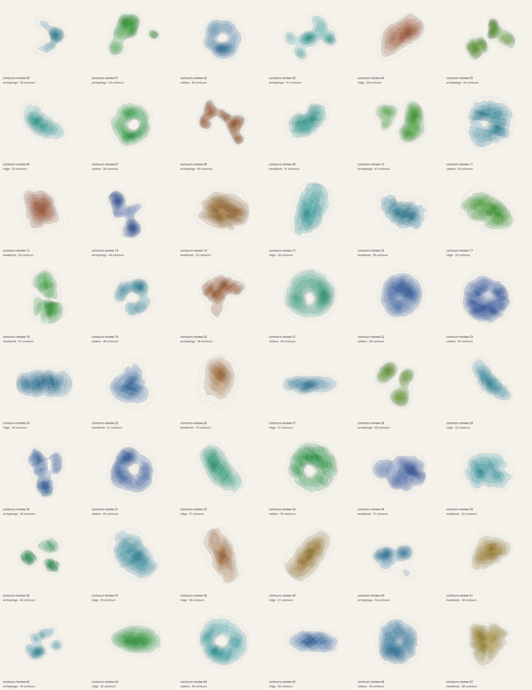
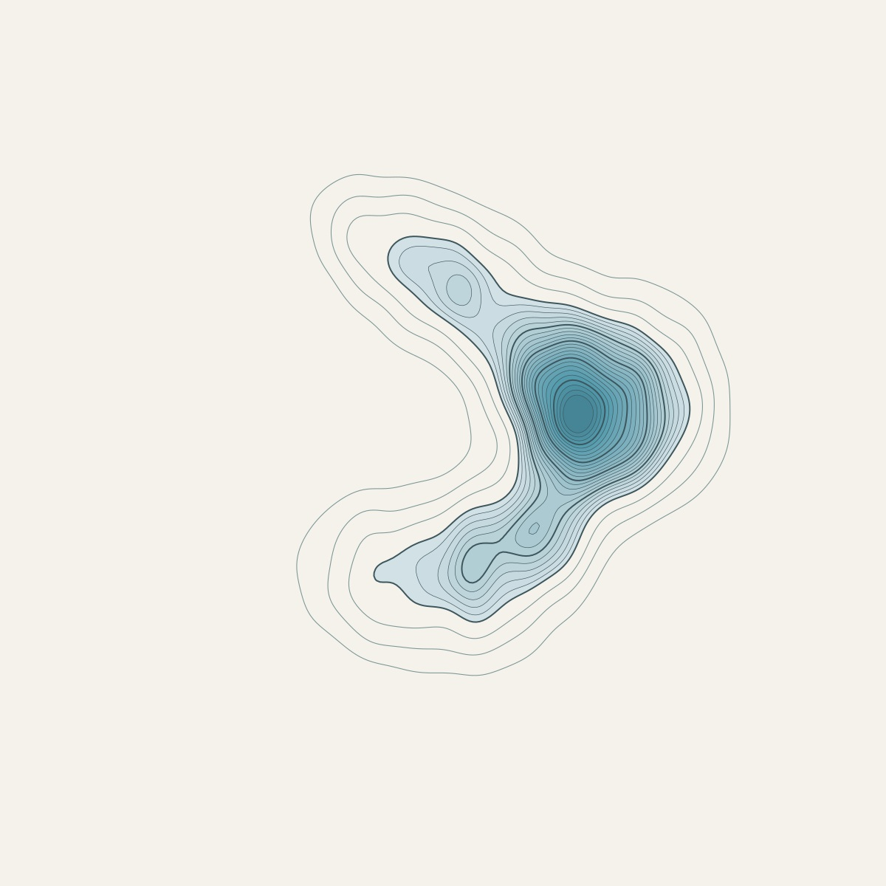
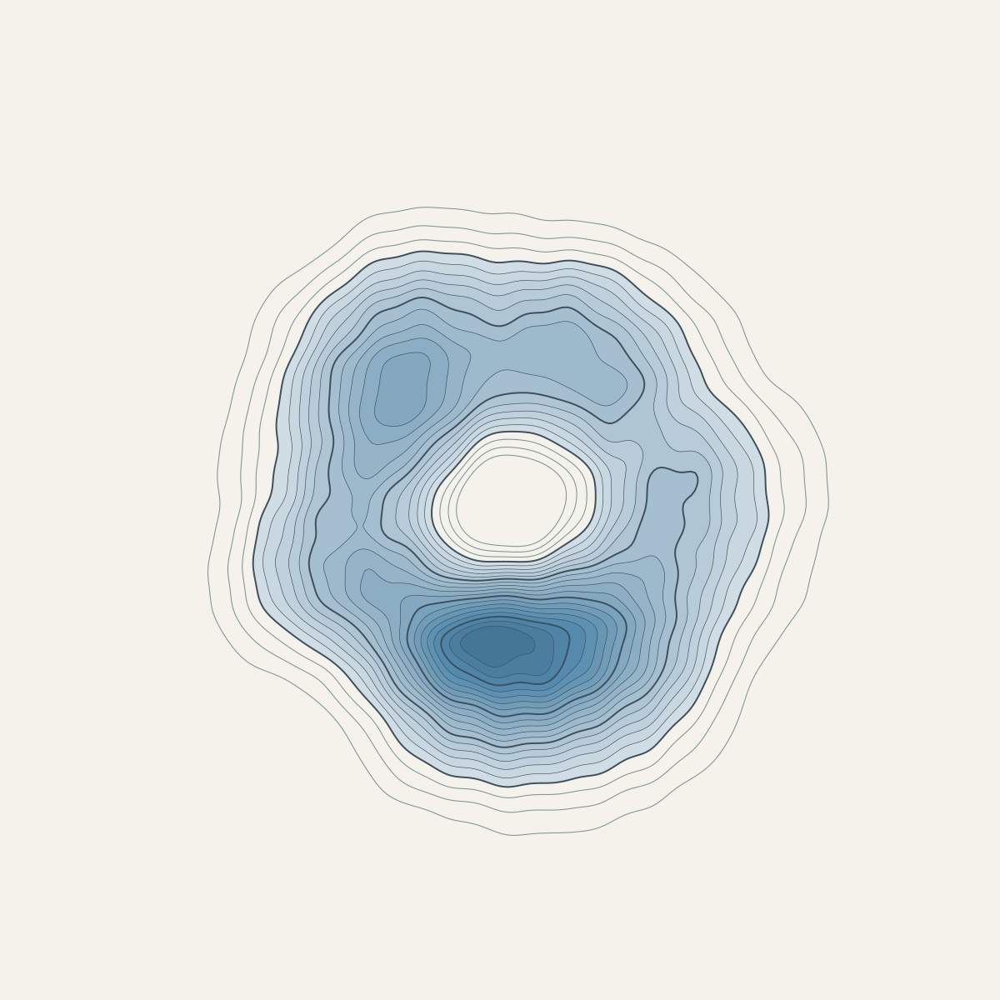
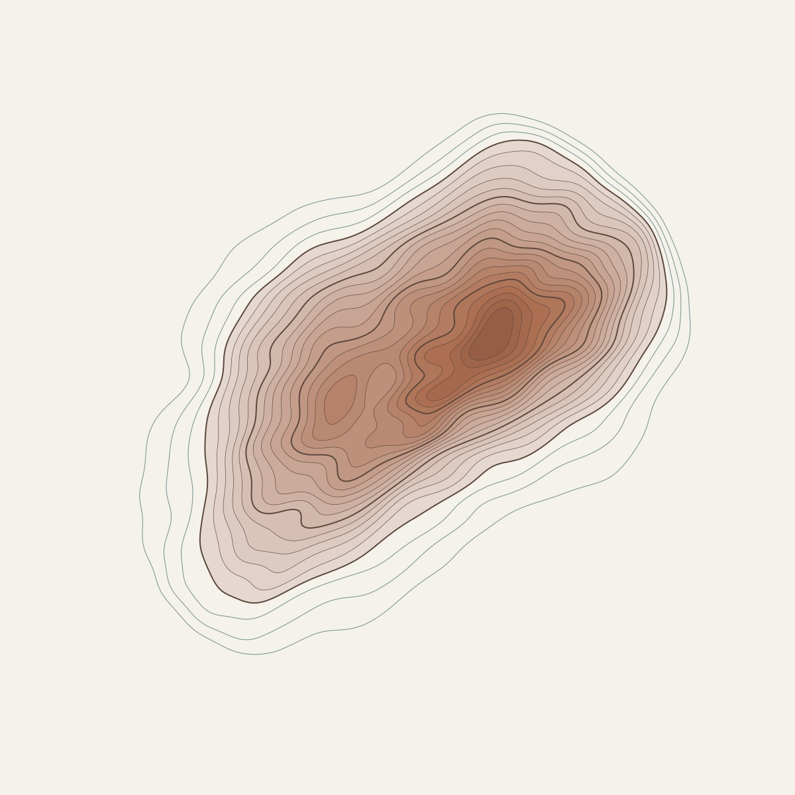
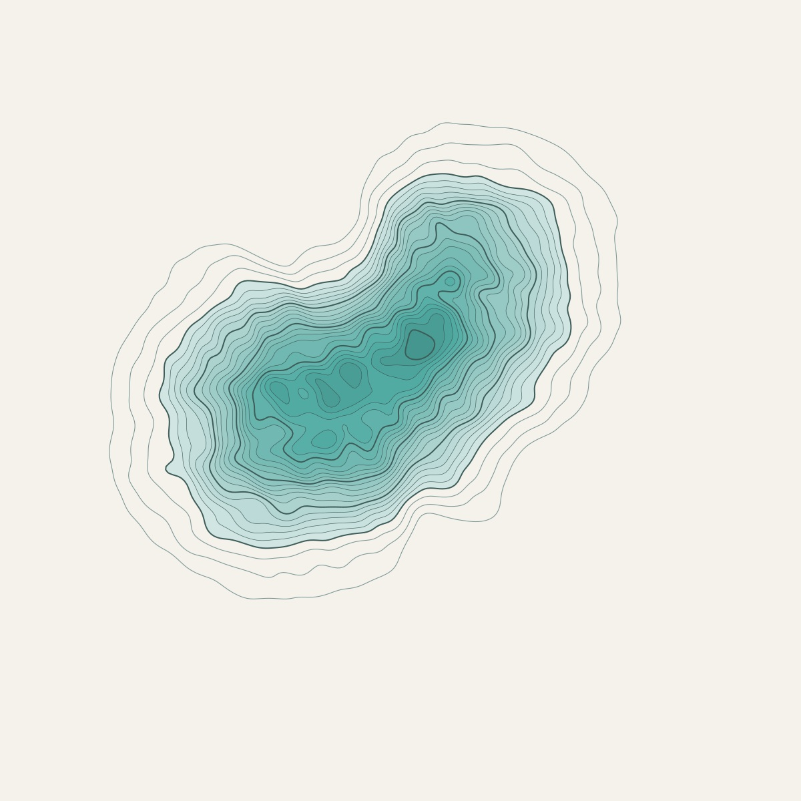
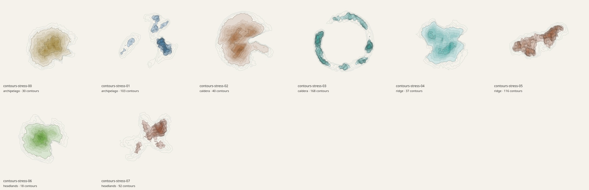

# Contours review

Contours makes imaginary topographic prints from seeded Gaussian peaks, negative valleys, finite Fourier roughness, and mathematically traced elevation levels. Its public controls cover the field, sampling, thresholds, family arrangement, and palette. The [generator reference](../src/generators/contours/README.md) provides every bound/default/unit, API examples, field equations, and a table mapping the Blinn and Nielson–Hamann papers to the implemented ideas. It also explains why this is not an erosion simulation or measured geography.



| Archipelago neighborhood: seed 00 | Caldera and lagoon: seed 02 |
| --- | --- |
|  |  |

| Ridge: seed 04 | Headlands: seed 09 |
| --- | --- |
|  |  |

## Recorded 48-seed audit

The final batch is `contours-review-00` through `contours-review-47`, rendered through the actual line-preview renderer at 1200×1200 pixels.

| Measurement | Recorded result |
| --- | --- |
| Unique SVG hashes / unique PNG hashes | 48 / 48 |
| Families | 13 archipelago, 11 caldera, 13 ridge, 11 headlands |
| Contour loops per painting | 19–62 |
| Coastline components across the batch | 57 islands and 8 lagoon holes |
| Land area as a fraction of the page | 6.96%–32.40% |
| Actual rendered ink coverage | 7.94%–33.92% |
| Pixels touching the image edge | 0 across all 48 |
| Generation time | Mean 223 ms; maximum 382 ms |
| SVG size | Mean 148 KB; maximum 240 KB |
| Grid | 241×241 for every default sample |

Timings are observations on the shared development machine, not guaranteed latency on every browser. Land fraction and raster ink coverage are different measurements: the former comes from signed coastline area, while the latter includes the visible shore strokes and fill bands.

The complete contact sheet shows varied connected masses, separated islands, elongated ridges, asymmetric ring forms, and several palettes. Full-size review of seed 02 confirms that its central lagoon is a real compound-path hole with nested contour geometry. Families overlap in appearance: an archipelago parameter neighborhood can merge into one island, and a caldera can have a filled center. They describe how terrain is constructed rather than promising a fixed silhouette. Contour bands near saddles or steep slopes can become closely spaced, which is meaningful terrain structure.

## Extreme controls



The eight rendered cases `contours-stress-00` through `contours-stress-07` combine opposing counts, spread, peak width, elongation, contour counts, and sea levels for each family. Both sides also use maximum roughness, warp, frequency, lacunarity, and valley depth with a low amplitude-decay exponent. The [extreme report](previews/contours-extremes-report.json) records each exact resolved parameter set; this is a deliberate stress selection rather than a sweep of every Cartesian combination.

All eight SVG and PNG hashes are distinct, and no image has ink at its edge. Raster coverage is 6.94%–26.80%. Mean generation took 257 ms, the slowest case took 348 ms, and the largest SVG was 279,753 bytes. Narrow, dispersed peaks and broad, merged peaks remain visibly different; higher spectral detail makes the contours more intricate without introducing a rectangular boundary crop.

## What the tests establish

The five generator test groups validate all 48 seeded outputs against the generating scalar field, not only their hashes. Every retained contour vertex agrees with its sampled bilinear level to `1e-9`. Seeded point probes at three levels compare the nonzero compound fill with the field's above/below classification, including true holes. Probes extremely close to a level are excluded because a straight segment approximates a bilinear curve inside a cell.

For each family, a 129²-to-257² comparison keeps the sampled maximum within .6%, page land fraction within .003, and the tested island count unchanged. Boundary and continuity tests verify that the field vanishes before the paper edge. Nearby changes to spread, peak width, roughness, warp, rotation, and valley depth change the evaluated height smoothly. Unicode-seed reproducibility, invalid-input rejection, and eight joint-extreme geometry configurations are also covered.

The shared marching-squares suite separately tests analytic-circle convergence, genuinely open boundary traces, correct bilinear saddle resolution in a case where the corner mean fails, an annulus, exact ties, and invalid fields. Closed positive-level contours, consistent winding, and sampled agreement with the height field support the filled-island representation. These tests are evidence over specified cases, not a proof that every arbitrary parameter combination has identical topology under refinement.

The full branch test run passed 62 tests in 28.5 seconds, and the production build passed. Chromium checks passed on desktop and at 390×844 portrait, 844×390 landscape, and 320×568 narrow-phone sizes. These exercised seed reload/history, a revision upgrade regenerating exactly once, paper and transparent PNG downloads with pixel/alpha checks, and SVG/PDF downloads.

## Reproduce and inspect

```sh
node --test tests/contours.test.mjs tests/isocontours.test.mjs
node scripts/art-review/contours.mjs --count 48 --out /tmp/contours-review --raster --width 1200
node scripts/art-review/contours.mjs --extremes --out /tmp/contours-extremes --raster --width 1200
```

The audit directory includes full SVG and PNG specimens, `contact-sheet.png`, and `report.json`. The committed [default report](previews/contours-report.json) and [extreme report](previews/contours-extremes-report.json) store exact resolved controls, seeds, hashes, generation times, SVG bytes, geometric metrics, raster coverage, and pixel bounds. The JPEGs above are documentation samples; the live style generates real vectors on demand and caches its results locally.

Remaining limits are explicit: finite sampling and the small-loop cutoff omit sub-grid features; the zero-height floor can introduce a derivative change; families can overlap visually; and the smooth support is a composition choice. Elevation colors carry no physical altitude or geographical meaning. Browser/export integration checks complement the mathematical and raster audits rather than proving the terrain model physically realistic.
