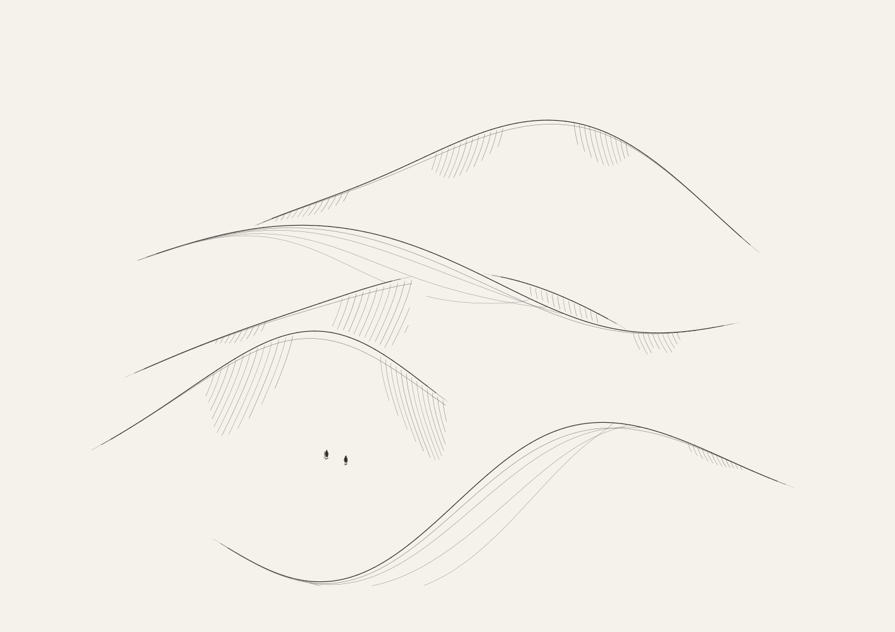

# Dune Fields — revision 2 review

The default style is now an open monochrome ink landscape: broad asymmetric dune crests, curved shoulder hatching, a few longer ripple traces, and tiny articulated travelers/camels. The older ochre surface study remains an explicit override. [Model, complete parameter reference, API, and primary-paper distinctions](../src/generators/dunes/README.md).

## Before and after

| Earlier shaded surface study | Revised flowing ink landscape |
| --- | --- |
|  |  |

The change goes beyond palette. The new continuous ridge surface composes a landscape across the page; sparse curved marks describe its shoulders without a filled slab or a dense wire grid. Crests use analytic surface heights so the visibility grid does not scallop the outlines. Short buried ridge remnants are removed, their associated marks are suppressed, and longer endings taper into the sand.

## Final 48 seeds


`dunes-review-00` through `dunes-review-47` were generated and rasterized through the actual application line renderer at 1414×1000 pixels.

| Measurement | Recorded result |
| --- | --- |
| Unique SVG hashes / unique PNG hashes | 48 / 48 |
| Placed travelers / camels | 91 / 68 |
| Default requested figure counts satisfied | All 48 seeds |
| Retained crest runs per scene | 4–8 |
| Ripple/hatch strokes per scene | 37–126 |
| Raster ink coverage | 1.04%–1.83% |
| Ink touching the image edge | 0 across the batch |
| Mean / maximum generation time | 245 ms / 377 ms |
| Mean / maximum SVG size | 117 KB / 146 KB |

The low ink fraction reflects deliberate open sand, not an incomplete shaded terrain. Timings are observations on the shared development machine, not guarantees for every device. The [full audit report](previews/dunes-report.json) preserves exact seeds, resolved controls, hashes, placement metrics, and pixel bounds.

## Details

A varied multi-summit composition, seed 00. The retained morphology labels now select illustrative ink profile neighborhoods; this is not a claim of planform star-dune geometry.


A broad flowing composition, seed 06.


A small caravan, seed 09. Solid miniature bodies make the people and camel readable, while jointed legs, variable proportions, load, heading, and planted feet remain procedural geometry.


The complete contact sheet and full-size specimens were inspected for unexplained floating crest fragments, clipping, dense wire patterns, badly formed silhouettes, and crowding. Earlier prototypes exposed two specific problems: overlapping phase lines and shoulder bands looked technical, and retaining every short buried crest fragment left unexplained little strokes. The final model uses selective curved marks and retained crest intervals instead. Figure outlines were strengthened into small ink silhouettes; the camel's lower neck and exposed hump read more clearly than the earlier long-neck outline.

## Stress review


The eight `--stress` cases cover low and high relief, crowded and widely spaced caravans, large and small figures, sideways and depth-directed headings, no figures, no hatching, extreme crest width/curvature, and the optional ochre renderer. All eight SVG and PNG hashes differ and all have zero edge clipping. The [stress report](previews/dunes-stress-report.json) records each exact case.

Ink-only stress generation ranged from 228 to 969 ms. The optional ochre case took 3.10 seconds; the complete eight-case mean was 768 ms. The largest SVG was 226,324 bytes. Ink-only and ochre coverage are intentionally different, so the combined 0.61%–32.39% coverage range should not be read as default ink density.

Two deliberately crowded requests could not fit all figures while preserving scale, visible terrain contact, and clear silhouettes. Stress seed 01 requested eight walkers and six camels and placed eight/two; seed 02 requested eight/six and placed six/three. Count controls are documented as requested maxima. The generator reports actual counts instead of overlapping or silently shrinking figures. All default seeds placed every requested figure.

## Geometry and integration checks

All **75 repository tests** and the production build pass. The 18 dune test groups include the original optional-model checks plus revision-2 properties:

- Every emitted terrain mark remains on its active surface, within print margins, and visible under the depth test. Extreme relief exercises adaptive ripple subdivision.
- Independent oblique viewing rays check the new ink surface, allowing less than three world units of sampled obstruction from the finite visibility grid. The optional ochre camera retains its separate independent eye-ray test.
- Every planted foot matches terrain height plus the `.12`-unit numerical offset. Figures retain visible foot contacts; body bounds do not overlap, and rendered figure strokes pass the terrain depth test.
- Articulated figures vary across seeds, zero counts remove them, and figure-only overrides leave the terrain drawing unchanged. Nearby continuous controls change the ink height field smoothly.
- The default landscape contains no filled terrain slabs. The bundled worker matches the source SVG/parameters and forwards revision 2.

Chromium checks passed on desktop and at 390×844 portrait, 844×390 landscape, and 320×568 narrow-phone sizes. Saved-seed reload/history, cache reuse, and exactly one regeneration after the revision upgrade pass. Downloads include 3200-pixel paper/transparent PNGs, SVG, and PDF; pixel checks verify dimensions, visible artwork, opaque paper, and transparent margins. [Fresh browser results](previews/dunes-browser-results.json).

The visibility buffer is approximate; tests cover specified seeds and extremes rather than proving all combinations. Tiny limbs disappear naturally in thumbnails. Ink morphology names indicate profile choices, and the view is an artistic oblique construction. The cited dune papers inspire sections and qualitative width relationships; neither renderer integrates sediment transport, predicts migration, or simulates a caravan's locomotion.

## Reproduce

```sh
node --test tests/dunes.test.mjs tests/isocontours.test.mjs
node scripts/art-review/dunes.mjs --count 48 --raster --width 1414 --out /tmp/dunes-review
node scripts/art-review/dunes.mjs --stress --raster --width 1414 --out /tmp/dunes-stress
npm test
npm run build
node scripts/check-browser.mjs
```

Raster review uses optional local Cairo `canvas` and `path2d`; browser verification needs Playwright/Chromium. The review directory contains every SVG/PNG and its JSON record. Committed JPEGs are review artifacts, while live art remains procedural and cached locally. SVG exports retain vector paths; the existing PDF exporter embeds a rendered PNG.
