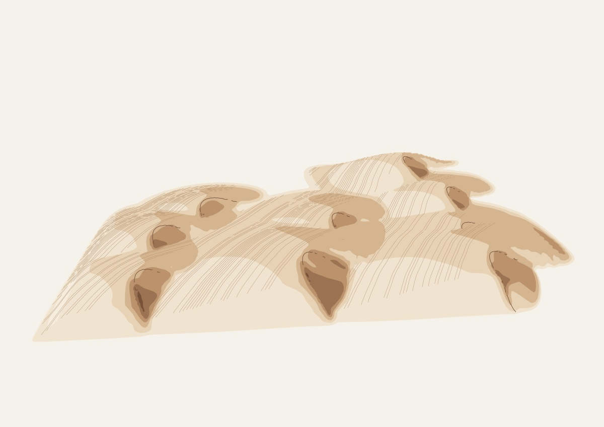

# Dune field review

The first 48 seeds, `dunes-review-00` through `dunes-review-47`, were generated
and rasterized with the application's line renderer at 1200 × 849 pixels.
All 48 SVG hashes and all 48 PNG hashes are distinct. The full contact sheet
was inspected, with larger views of each morphology, the darkest barchan
fields, and the least contrasted examples.


| Family | Samples |
| --- | ---: |
| Barchan | 13 |
| Transverse | 11 |
| Linear | 14 |
| Star-inspired | 10 |

The four families use different ridge equations and wind relationships.
Within a family, seeds change the wind direction, scale, relief, curvature,
spacing, ripple phase, camera and light. These are geometric illustrations
inspired by dune papers; they do not simulate sediment transport or predict
real dune evolution. The [algorithm documentation](../src/generators/dunes/README.md)
links the primary papers, identifies the equations adopted, and lists all
supported parameter overrides.

## Full-size examples

Star arms share summits and merge into one terrain surface (`dunes-review-00`).


Transverse ridges cross the primary wind and show asymmetric windward and
lee slopes (`dunes-review-01`).


Linear ridges follow a resultant of two wind directions. This low camera
angle emphasizes their longitudinal shape (`dunes-review-06`).


Barchan horns taper downwind. A pale base tone preserves the fully lit faces
under this softer lighting (`dunes-review-09`).


The darkest barchan example makes the finite lighting contours easier to
inspect (`dunes-review-33`). Illumination normals are filtered at the terrain
sampling scale, and the lighting filter follows the local projected depth
plane. Shadow rays refine their strongest obstruction. These changes smooth
shade transitions without changing the terrain, coverage or occlusion.



## Verification

The final batch contains 83–1,456 paths per scene. SVG sizes range from
49–408 kB, averaging 171 kB. Local generation averaged 2.46 seconds; the
slowest was 4.76 seconds while parallel validation was running. These are
observations from the review run, not a cross-device performance guarantee.

Raster checks found no empty images, saturated frames or ink touching the
image edges. Visible coverage ranged from 9.1% to 34.4%. Across the batch,
measured colored ink stayed within x = 60–1,142 and y = 196–779 in the
1200 × 849 review images. Very pale sand is excluded from that ink threshold;
separate vector-coordinate checks enforce the margins for every path.

Fourteen dune tests and four shared contour tests pass. They check:

- The cosine-power stoss section, parabolic crest envelope, slip angle and
  wind-shear/saturation width relationships adopted from the papers.
- Downwind horns at asymmetric extremes, connected star arms, and the
  expected transverse/linear wind alignment.
- Analytic bicubic normals against finite differences, unit upward normals,
  perspective scale, reciprocal-depth lighting and draw-order-independent
  visibility.
- Refined terrain-shadow rays, filtered illumination normals, smoothing along
  sloping faces without crossing visibility breaks, and contour winding that
  keeps illuminated holes open.
- Surface-attached texture, suppression of phase-root jumps, 48 unique
  bounded fields, and eight combinations of extreme controls.
- Independent rays from emitted texture toward the camera eye at minimum
  camera elevation, maximum relief and maximum perspective. The largest
  sampled terrain obstruction was below 1.50 world units, within the
  2-unit allowance for the finite terrain and visibility grids.
- Seed determinism and exact SVG/parameter parity with the bundled classic
  worker.

Eight additional native raster specimens covered the monochrome palette,
minimum camera elevation with maximum relief, and an almost overhead view
of low star dunes. They were also inspected for clipping, unstable texture
and disconnected geometry.

The renderer uses a sampled height surface and finite lighting/depth grids.
Very close inspection can reveal small contour facets and broad stepped shade
boundaries at dune intersections; the diagnostic image above shows this limit. Texture is intentionally sparse on lee slopes;
a low viewpoint can hide most of a distant ridge. The monochrome option and
all high-level controls remain available through `generateDunes(seed, overrides)`.

## Reproduce

```sh
node --test tests/dunes.test.mjs tests/isocontours.test.mjs
node scripts/art-review/dunes.mjs --count 48 --raster --out /tmp/dune-review
node scripts/art-review/dunes.mjs --count 4 --raster --out /tmp/dune-ink \
  --prefix dunes-ink --overrides '{"palette":"ink","cameraElevation":0.6}'
node scripts/art-review/dunes.mjs --count 2 --raster --out /tmp/dune-low \
  --prefix dunes-low --overrides '{"morphology":"barchan","cameraElevation":0.22,"perspective":0.5,"crestHeight":95,"relief":1.55}'
node scripts/art-review/dunes.mjs --count 2 --raster --out /tmp/dune-high \
  --prefix dunes-high --overrides '{"morphology":"star","cameraElevation":0.95,"crestHeight":22,"relief":0.55,"saturationLength":30,"rippleWavelength":24}'
```

Raster review uses optional local `canvas` and `path2d` packages. The audit
writes each SVG/PNG, a contact sheet, JPEG examples and `report.json`, including
exact parameters, hashes, elapsed generation time, path/byte counts and
pixel bounds. These review packages are not runtime dependencies.

The [final 48-sample report](previews/dunes-report.json) and
[eight-sample stress report](previews/dunes-stress-report.json) preserve the
exact reviewed parameters and hashes.


## Application integration

The final full repository suite passed all **71 tests**, followed by a production build and Chromium verification. Desktop and 390×844, 844×390, and 320×568 phone checks preserve the landscape page ratio and keep the complete artwork visible. Saved-seed reload/history, cache reuse, and exactly one regeneration after a revision upgrade pass. Downloads include 3200-pixel paper and transparent PNGs, SVG, and PDF; PNG pixel checks verify visible artwork, dimensions, opaque paper, and transparent margins. [Recorded browser results](previews/dunes-browser-results.json).

Run `npm test`, `npm run build`, then `node scripts/check-browser.mjs` to reproduce; the last command requires Playwright and Chromium. SVG retains vector paths; the existing PDF exporter embeds a rendered PNG.
