# Dune Fields — revision 3 panoramic review

Dunes now uses the same framing as Landscapes: a **3200×800 source panorama** and a **central 800√2×800 print window**. This is a wider procedural terrain field, with independently varying summits and hatching across its width. The complete SVG retains that geometry; print crops select its middle without distorting it. Tiny articulated travelers and camels remain grounded and fully inside the print crop.

[Model, complete parameter reference, API, and primary-paper distinctions](../src/generators/dunes/README.md).

## Wider terrain and its print crop

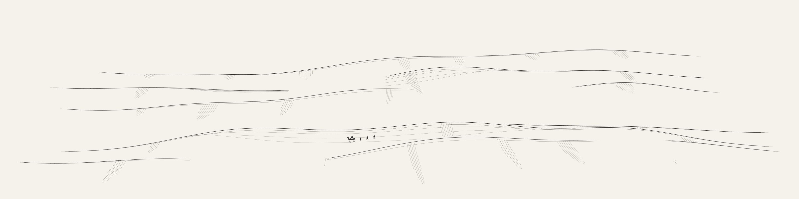

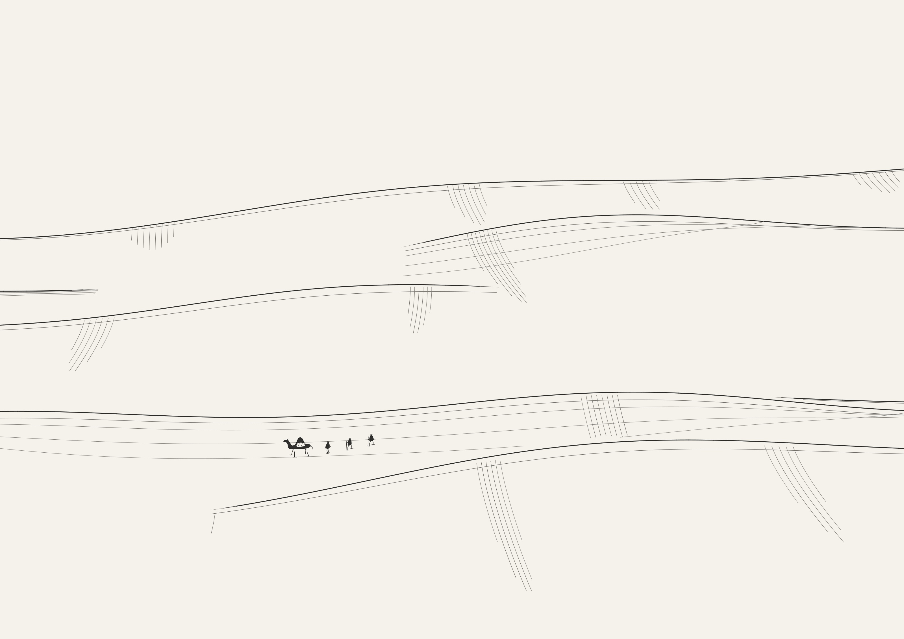

The monochrome scene retains sweeping layered crests, curved shoulder hatching and long ripple traces. Each ridge now has three separately varied summit regions across a 4400-world-unit field, so both outer scenery and the middle crop contain actual relief. The optional ochre palette combines independently seeded neighboring planform fields in one continuous sampled surface, with shared lighting and visibility.

The earlier revision used a compact 1414×1000 scene:

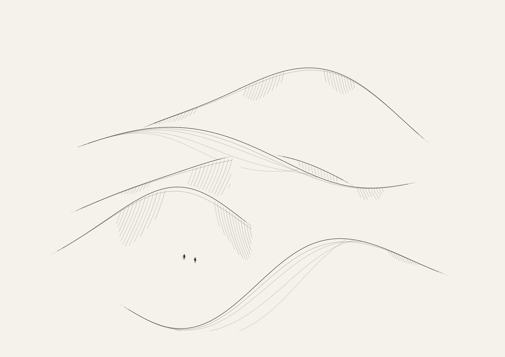

## Final 48 seeds

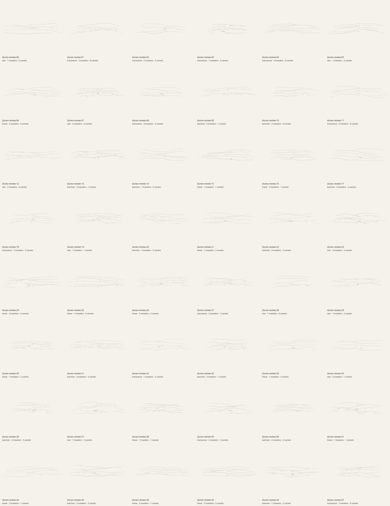

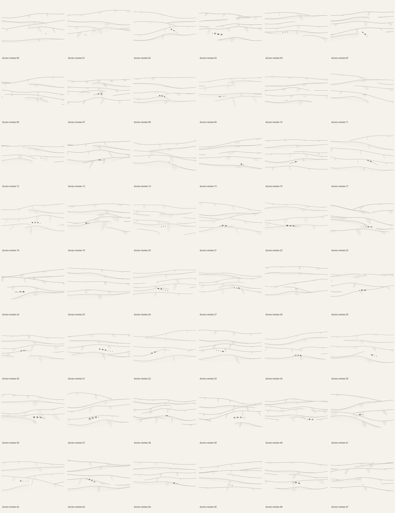

`dunes-review-00` through `dunes-review-47` were generated and rasterized through the actual application line renderer. Panorama rasters are 3200×800; crop rasters are 3200×2263, preserving the √2 print ratio to integer-pixel rounding. The crop contact sheet contains the exact central regions of the corresponding full scenes.

| Measurement | Recorded result |
| --- | --- |
| Unique source SVG / panorama PNG / crop PNG hashes | 48 / 48 / 48 |
| Placed travelers / camels | 91 / 68 |
| Default requested figure counts satisfied | All 48 seeds |
| Retained crest runs per scene | 5–13 |
| Ripple/hatch strokes per scene | 105–310 |
| Panorama ink coverage | 1.60%–2.51% |
| Central crop ink coverage | 1.57%–2.62% |
| Ink touching any panorama edge | 0 across the batch |
| Ink touching crop top/bottom edges | 0 across the batch |
| Mean / maximum generation time | 630 ms / 992 ms |
| Mean / maximum source SVG bytes | 328,085 / 396,779 |

[Exact default parameters, geometry hashes, raster hashes, placement metrics, bounds and timings](previews/dunes-report.json). Timings describe this local run and depend on the machine and concurrent work; they exclude raster/export time. Horizontal ridge crossings at print-crop edges are intentional. Every figure's body bounds retain at least 12 source units of horizontal crop clearance.

Additional source and print examples:

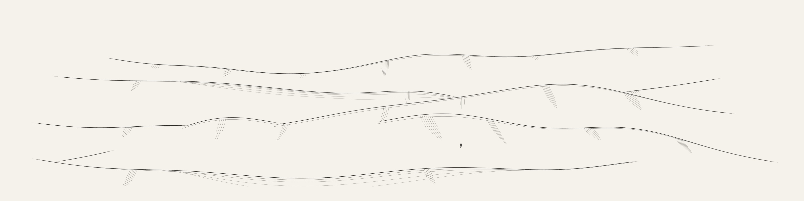

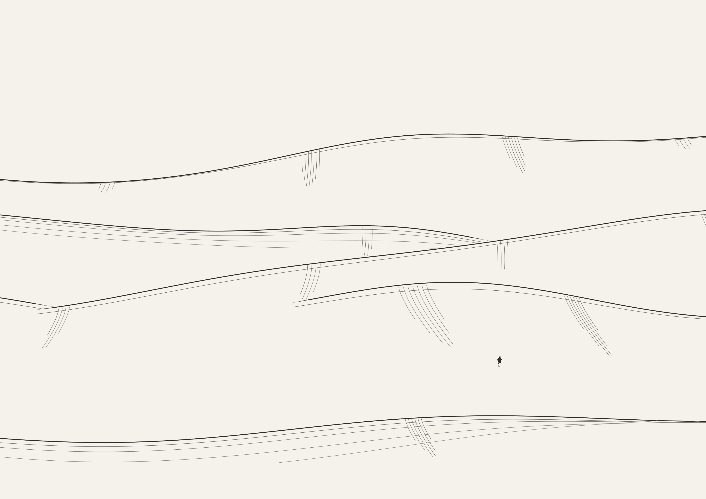

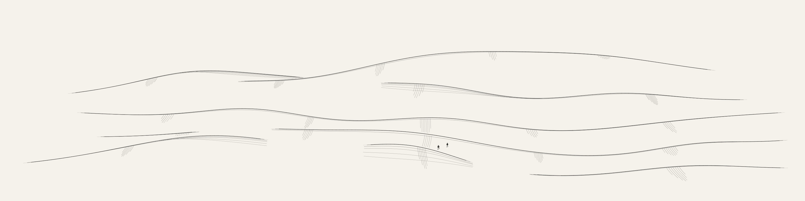

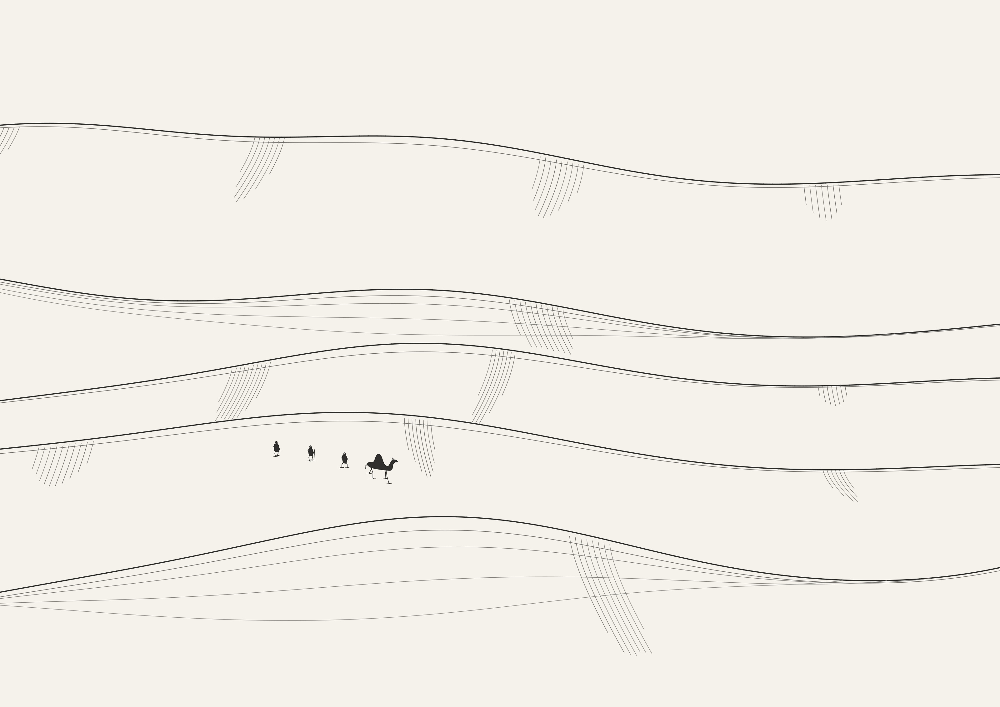

The ink labels are illustrative profile families, not claims to reconstruct a measured star dune or barchan planform. Summit positions, widths, heights and overlaps vary continuously with seeded parameters; the illustrated panorama does not repeat a single finished drawing.

## Eight stress cases

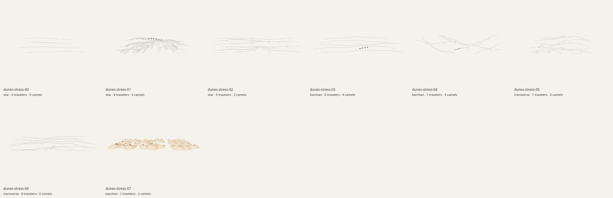

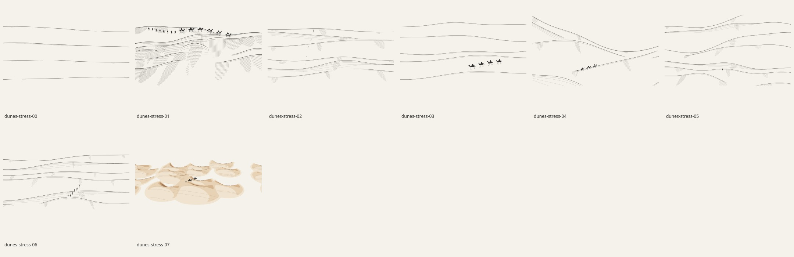

The cases cover low relief without figures, maximum hatching with a large caravan, a long route heading into the distance, isolated large camels without ripples, high asymmetric barchan-style relief, short crests with strong curvature, a compact group of eight people, and the optional ochre renderer. [Exact overrides and measured results](previews/dunes-stress-report.json).

All eight source SVGs, full PNGs and crop PNGs are distinct. No full-panorama edge or crop top/bottom edge contains ink. Panorama coverage ranges from .89% to 29.42%; crop coverage from 1.34% to 30.75%. The upper ends belong to the intentionally shaded ochre case, rather than the normal ink palette.

The maximum-count side-view case fits all eight people and six camels. The route facing into the distance requests eight people and six camels but places five people and two camels: visibility, uneven-ground, silhouette clearance and crop containment take priority over requested maxima. This shortfall is explicit in the report.

The eight-case mean is 1.73 seconds. Ink cases take 458–1418 ms in this run; the wider optional ochre lighting case takes 7.57 seconds. The largest source SVG is 651,236 bytes. Generation runs in a worker and completed paintings remain cached; optional ochre is substantially slower than the default ink rendering.

## Geometry validation

The 18 focused Dunes test groups retain the analytic profiles, planform orientation, bicubic derivatives, perspective, shadows, lighting filtering and nonzero-winding tests. The revised checks cover:

- All 48 seeded fields are unique, finite, bounded and visibly populated in each panorama third. Their central regions retain substantial vertical relief, and complete figure bounds lie inside the print window.
- Every emitted terrain mark stays on its active surface and passes visibility checks. Extreme relief exercises adaptive ripple subdivision.
- Independent oblique viewing rays test ink geometry with less than three world units of sampled obstruction. Independent perspective eye rays test the optional ochre geometry with the original stricter two-unit allowance.
- Every planted foot matches terrain height plus its .12-unit numerical offset. Visible foot contacts, body separation and depth-tested figure strokes remain checked.
- Articulated figures vary across seeds; zero counts remove them; changing figure controls leaves the terrain drawing unchanged; nearby continuous controls deform the ink height field smoothly.
- The default ink terrain remains unfilled. Classic-worker parity checks revision 3, source SVG geometry, resolved controls and separate source/print dimensions.

Focused geometric checks and final raster audits passed. The combined refinement also passes all 122 repository tests, the production build and Chromium desktop/mobile/cache/export checks; see the [integration evidence](refinement-review.md) and [current Dunes browser report](previews/dunes-browser-results.json).

Visibility remains a finite-grid approximation, and tests cover specified seeds and extremes rather than proving every parameter combination. Tiny details disappear naturally in wide thumbnails. The ink camera is an artistic oblique construction. The cited dune papers inspire sections and qualitative width relationships; neither renderer integrates sediment transport, predicts migration, or simulates caravan locomotion.

## Reproduce

```sh
node --test tests/dunes.test.mjs tests/isocontours.test.mjs
node scripts/art-review/dunes.mjs --count 48 --raster --width 3200 --out /tmp/dunes-review
node scripts/art-review/dunes.mjs --stress --raster --width 3200 --out /tmp/dunes-stress
```

Raster review uses optional local Cairo `canvas` and `path2d`. Each output directory contains every panorama SVG/PNG, matching `-crop` SVG/PNG, separate contact sheets, and exact JSON records. Committed JPEGs are review artifacts; live art remains procedural. SVG exports retain paths, PNGs use the application renderer, and the existing PDF exporter embeds a rendered PNG.
