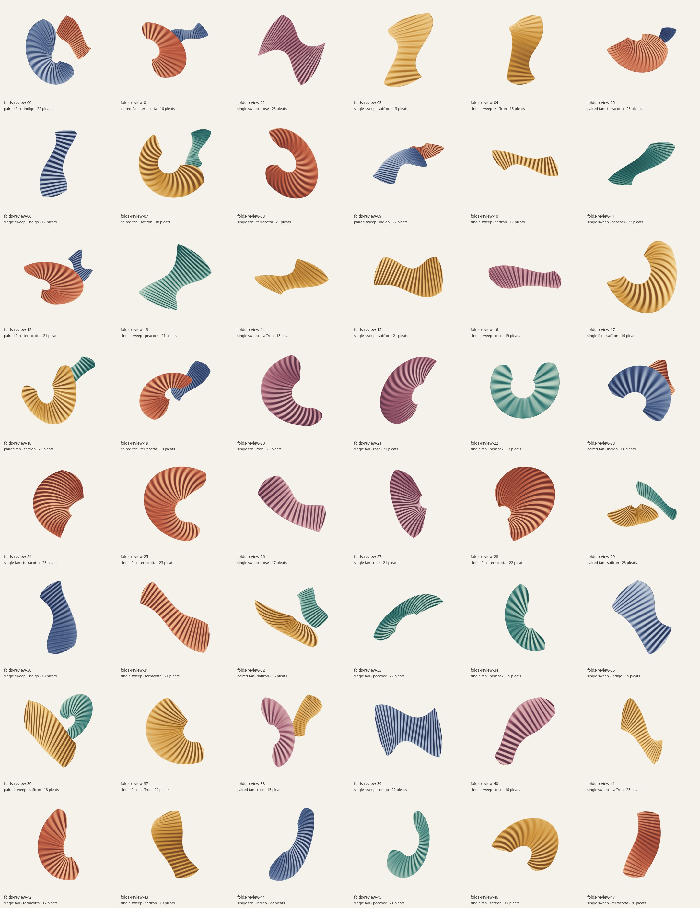
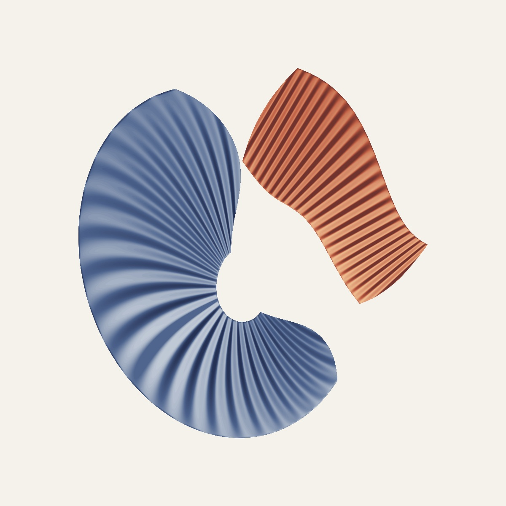
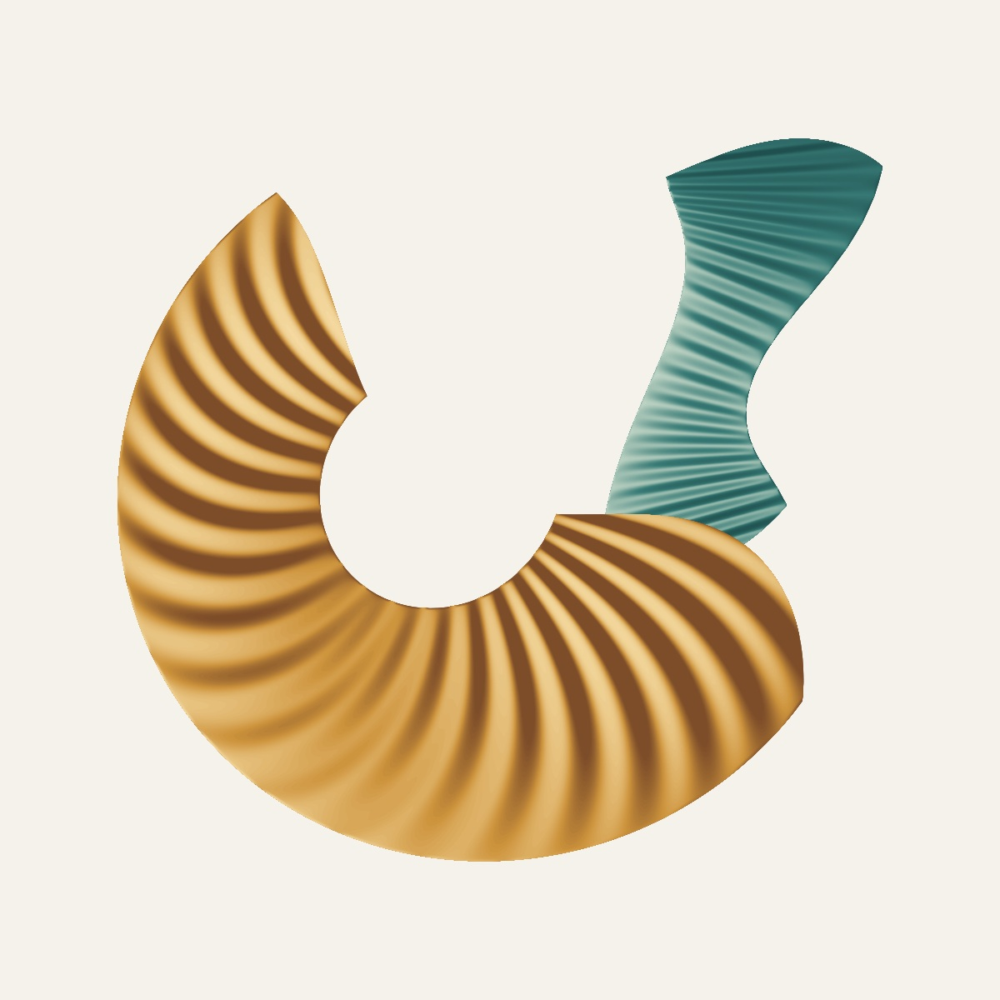
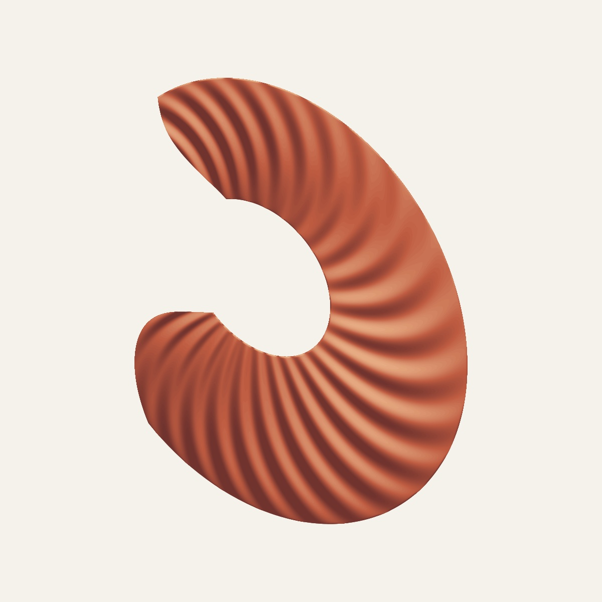
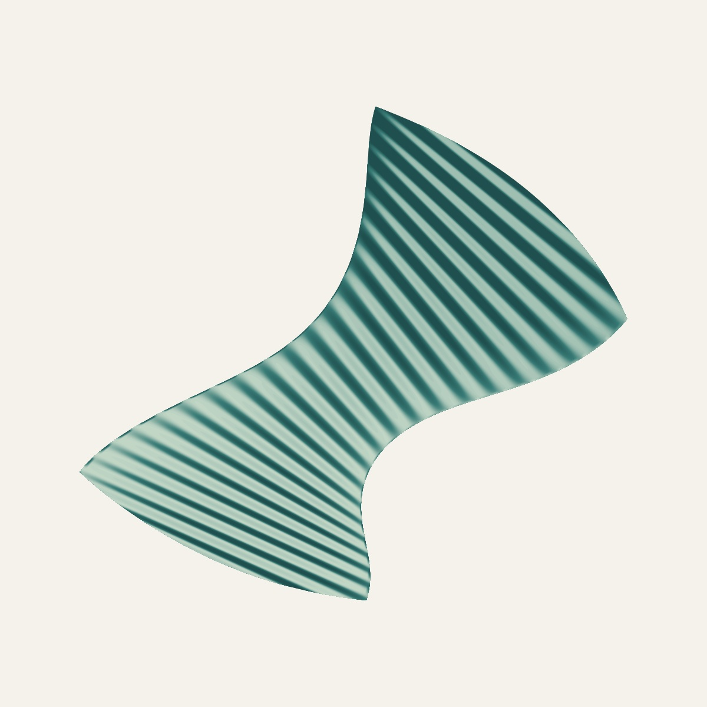
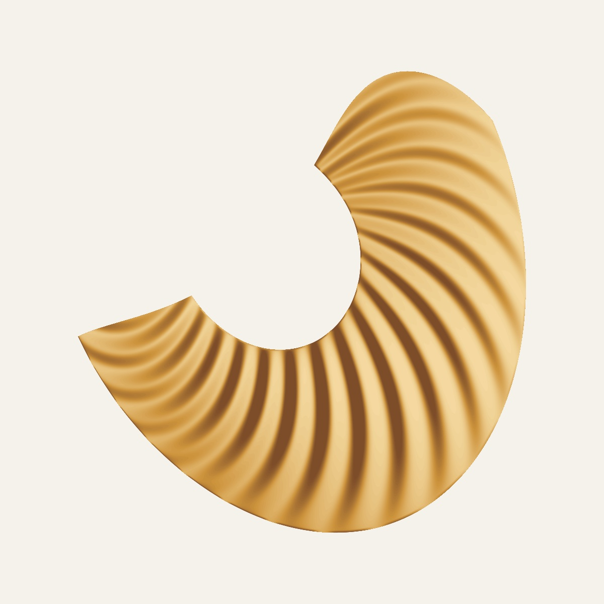
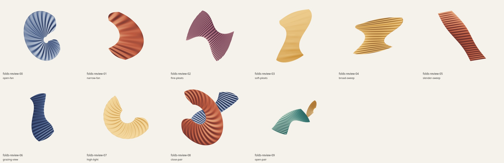

# Folded Light: generation review

Folds creates broad curved sheets with smooth pleat shading, open negative
space and occasional complementary pairs. Every silhouette, fold, free edge,
orientation and light response comes from seeded equations. The surfaces use
a decorative relief/bump-shading model; they are not physically developable
origami or a cloth simulation.



The final batch contains `folds-review-00` through `folds-review-47`, rendered
at 1200×1200 through the app's actual Canvas line renderer:

| Check | Result |
| --- | --- |
| Distinct SVG geometry / raster images | 48 / 48 |
| Surface families / palettes | 2 / 5 |
| Single / paired compositions | 35 / 13 |
| Colored page coverage | 9.78–33.74% |
| Page-edge ink | 0 pixels in every specimen |
| Filled SVG paths | 47–94 |
| Generation time | 1.36 s mean, 2.90 s maximum |
| Largest SVG | 1,591,571 bytes |

Timings are from the local review run, concurrent with the geometry tests;
they are observations rather than browser performance guarantees. Each audit
record includes SVG/PNG SHA-256 hashes, exact primary controls, all derived
sheet parameters and placement, projection Jacobian extrema, contour counts,
coverage and pixel bounds. A subsequent source-only pass matched all 48
recorded SVG hashes while completing the surface metadata.
The complete records are available as the [48-seed report](previews/folds-report.json)
and [ten-study report](previews/folds-extremes-report.json).











I inspected the complete contact sheet and full-size examples covering single
and paired sheets, narrow inner openings, strong twists, long horizontal
gestures and broad sweeps. The final set has clean silhouettes, coherent fold
direction and ordered overlaps. Shading remains visibly quantized when enlarged
beyond the review size; this is a deliberate editable-vector approximation.
The smallest pleats can blend together at thumbnail scale.

## Extreme controls



The ten fixed studies cover maximum/minimum fan opening, fine/soft pleats,
short broad and long slender sweeps, grazing camera/light angles, bright light,
and close/open paired compositions. They produced ten distinct SVGs and PNGs,
with no edge ink, 11.30–40.13% page coverage, 43–94 paths and a largest SVG of
2,324,510 bytes. Generation averaged 1.30 s and peaked at 2.64 s in that run.
The deliberately shallow relief case is pale; the zero-curvature slender case
has straight cut ends because its `endRound` override is explicitly zero.

The tests use additional seeds for the same ten studies. Supported individual
control ranges do not imply every Cartesian combination is valid: the generator
rejects a projected sheet that reverses orientation or approaches a singularity.
It never swaps in another seed or silently changes an explicitly requested
main-sheet camera. Default cameras are selected within the feasible projection
range before the parameter recipe is returned.

## What validation found

The first prototype exposed separate shaded quad cells and sharp accordion
edges. Continuous lighting bands and smooth free edges removed the visible
mesh. Broad sweeps initially allowed their offset boundaries to fold over; the
curvature-width limit and projection guard removed those cases.

Two later numerical checks found issues that were hard to see on the contact
sheet. Polyline simplification could cross tiny lighting loops, so those loops
now retain their original geometry. The original lighting grid underestimated
some narrow highlight peaks by about .048; increasing sampling to 48 intervals
per pleat and 96 across the sheet resolved the independent point-in-band checks.

An additional 512-seed default-camera audit initially found two narrow fans
whose high arches could turn away from the camera. The parameter factory now
derives a feasible default tilt from the projection Jacobian and records that
chosen tilt in the recipe. Both cases are permanent regressions. The revised
guard audit passes all 512 seeds and their 632 primary/companion surfaces.
This change preserved every SVG hash in the 48-seed gallery and ten-study batch.

All nine test groups pass. They verify analytic planar/annular coordinates,
normals, illumination and projection Jacobians; the exact sinusoidal relief
derivative; shared rotation of material and light; simplification error;
nonzero-winding agreement with continuous lighting; overlapping-sheet coverage
and drawing order; every filled loop's self-crossings and page bounds across
48 seeds; 512 fresh default recipes with their derived companions; diverse
extremes; unsafe-projection rejection; and source/worker
SVG, revision and parameter/metric parity.

The [generator README](../src/generators/folds/README.md) gives the equations,
control ranges and research attribution. Blinn's 1978 normal-perturbation idea
informs the rendered relief. Tang and colleagues' ruled-surface work informs
the continuous sheet construction; its developability solver is not implemented.

## Reproduce

```sh
node --test tests/folds.test.mjs
node scripts/art-review/folds.mjs --count 48 --raster --out /tmp/folds-review
node scripts/art-review/folds.mjs --studies --raster --out /tmp/folds-extremes
```

Raster review requires optional local `canvas` and `path2d` packages. Omitting
`--raster` still produces the SVG gallery and numerical records. The app adds no
runtime package for this style. Browser cache, navigation and PNG/SVG/PDF export
checks are handled by the repository's shared integration and browser suites.

## Application checks

All **62 repository tests** pass on the final source, followed by the production build and Chromium verification. Desktop and three phone viewports preserve the square frame and show the complete artwork. Seed URL/reload/history, cache reuse and exactly one regeneration of stale revisions pass. Downloads include SVG, 3200-pixel paper and transparent PNGs, and PDF; pixel checks verify visible artwork, opaque paper and transparent margins. [Browser records](previews/folds-browser-results.json). SVG stays vector; the current PDF embeds raster artwork.
