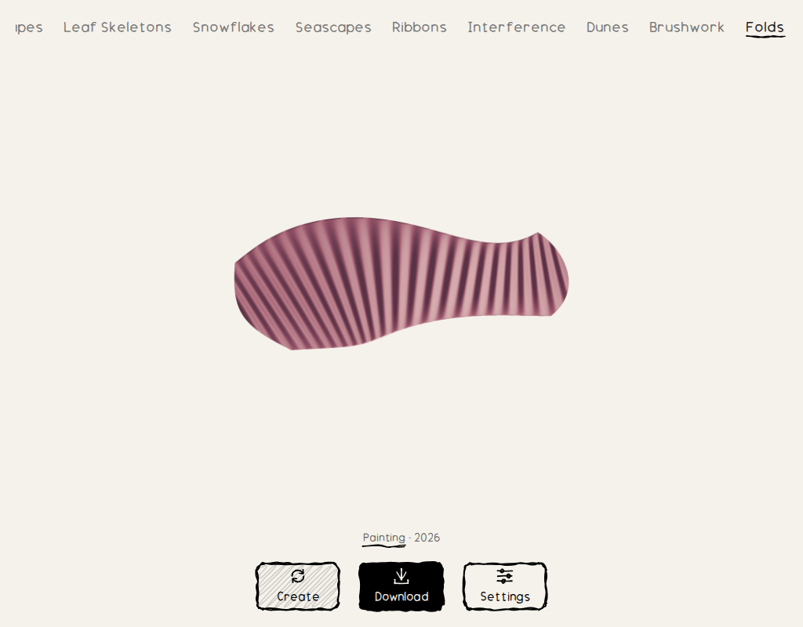
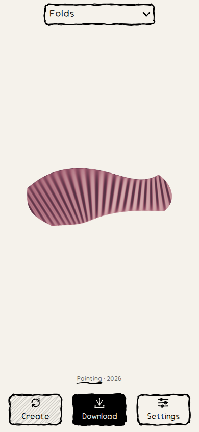

# Combined gallery integration

This change integrates the eight open feature PRs while retiring Cityscapes and Houses. The retained gallery contains Flowers, Landscapes, Leaf Skeletons, Snowflakes, Seascapes, Ribbons, Interference, Dunes, Brushwork and Folds.

| Feature PR | Integrated head | Review |
| --- | --- | --- |
| #1 Leaves | d12e1cdcd1b5a27ff93d99ce7313cc1b57eb9ca4 | [Model and examples](../src/generators/leaves/README.md) |
| #2 Snowflakes | fb6b8dc56ef4f614f089577ce9df538d69985bc8 | [Model and examples](../src/generators/snowflakes/README.md) |
| #3 Seascapes | fb5390a0b0a229444f86eb85aec854c777bf87cb | [Gallery and parameter review](seascapes-review.md) |
| #5 Ribbons | 47689b4569ee9bb35d04dccb75108b2ef17772eb | [Gallery and parameter review](ribbons-review.md) |
| #7 Interference | fec4c4bb855083566d936a4764eb8b9d47acec5a | [Gallery and parameter review](interference-review.md) |
| #8 Dunes | 346f40ebb82a568c6c2ecbd2404fab1d28516a44 | [Gallery and parameter review](dunes-review.md) |
| #9 Ink Gestures | 1d5f94192ea336bfcf4aca42e81e4839467cc4d4 | [Gallery and parameter review](brushwork-review.md) |
| #10 Folded Light | cee38e762ba8a42db7f4394442ce3144fbd65114 | [Gallery and parameter review](folds-review.md) |

Each feature head is preserved as a merge ancestor. The previously closed Reaction and Contours PRs are excluded. Shared-file conflicts retain the newer preview fill handling, frame sizing, generic cache revisions, desktop scrolling tabs, phone selector and browser checks. Snowflakes now declares revision 1 in both its pure result and project metadata, matching its existing worker revision without changing drawing geometry.

Cityscapes and Houses are removed from the registry, navigation, metadata, generator sources, stock-cache manifest, cached images/sources, style-specific CSS and exclusive tests. Their obsolete build helper and kernel loader are removed. Go setup is no longer needed in either CI workflow. Flowers' AssemblyScript kernels and the shared helpers used by the retained generators remain. The stock-cache baker defaults to Flowers and Landscapes; the newer styles generate on demand.

## Validation

- All **134 repository tests pass** on the combined source.
- `npm run build` passes without a Go toolchain.
- Chromium visits all ten retained styles in a single desktop session, then switches through all ten with the phone selector while preserving each displayed seed. Registry, tabs and picker choices agree; the selected desktop tab stays visible.
- Every new style passes direct-seed loading, reload/cache reuse, revision regeneration, Create/back navigation, full-frame desktop/three phone layouts, and SVG, 3200px transparent/paper PNG and PDF downloads. Pixel checks inspect nonblank content, page ratio, opaque paper and transparent margins.
- Both retired routes return 404 from the production static build. Their route folders, workers, cache folders and manifest entries are absent.

[Recorded navigation](previews/integration-navigation.json) and [browser/export measurements](previews/integration-browser-results.json) preserve the actual checked seeds and output sizes. These integration checks complement each feature's committed sample galleries and mathematical tests.





## Reproduce

```sh
npm ci
npm test
npm run build
npm install --no-save --package-lock=false playwright@1.58.2
npx playwright install chromium
node scripts/check-browser.mjs
```

Run test and build sequentially: both prepare the same generated output directory. Browser artifacts are written under `.artifacts/browser/`. SVG exports preserve each source format; the current PDF exporter embeds raster artwork.
