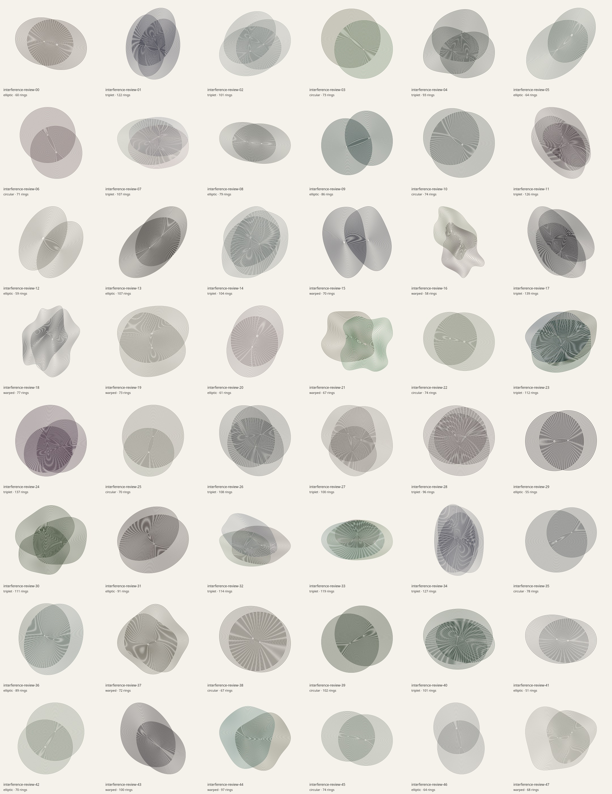
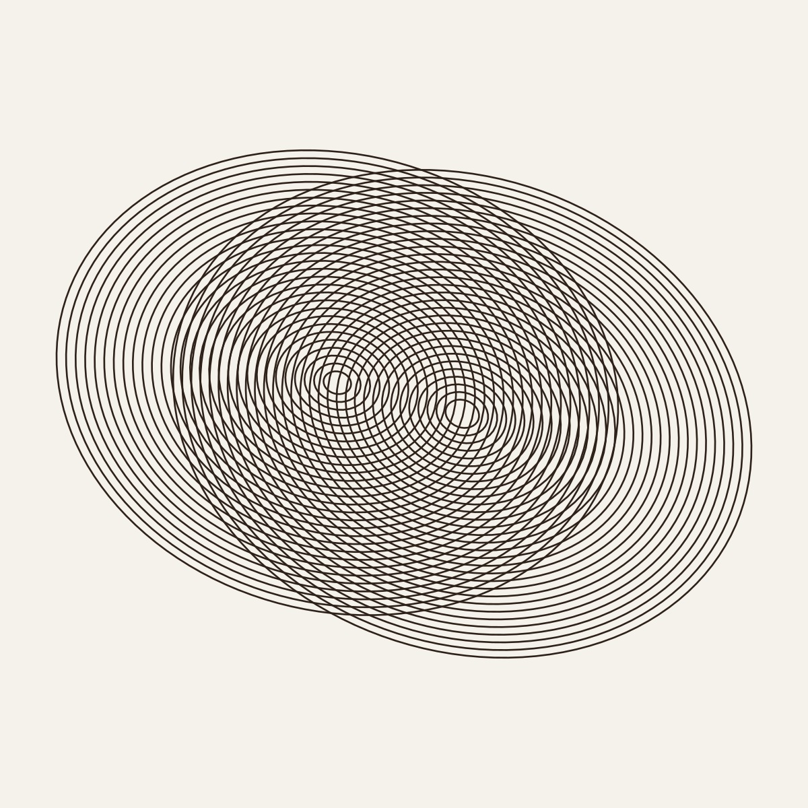
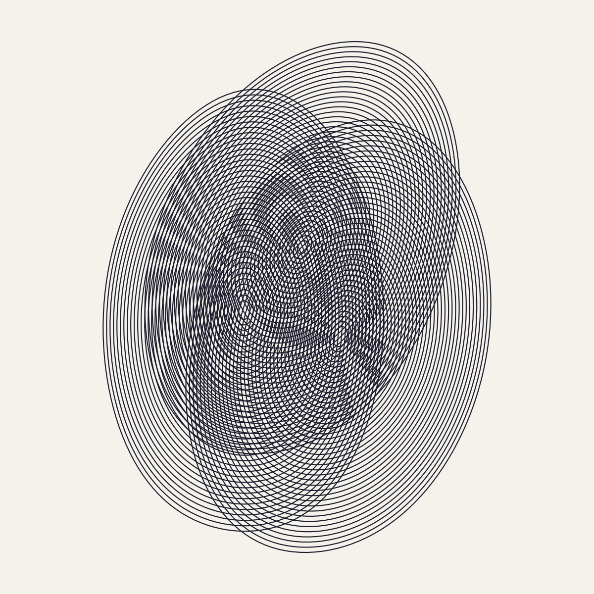
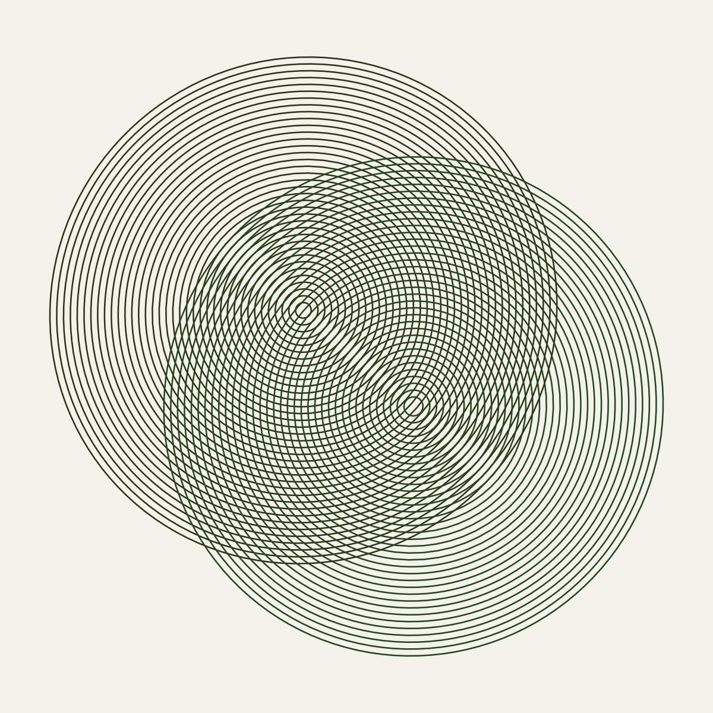
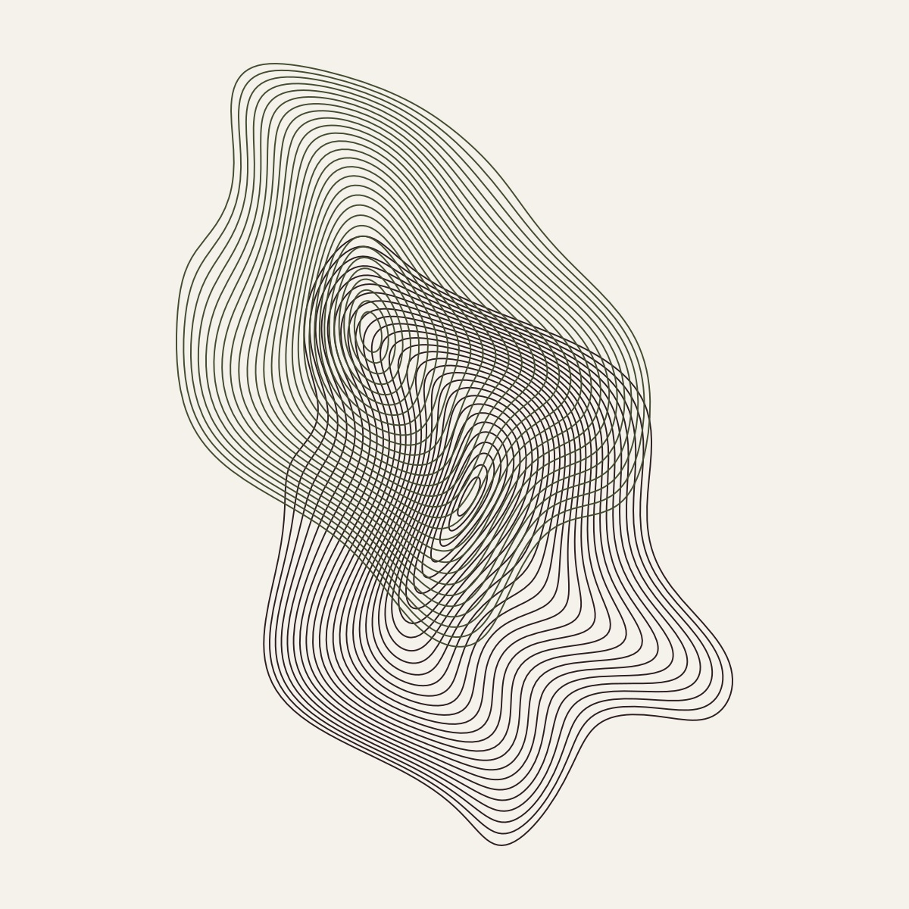
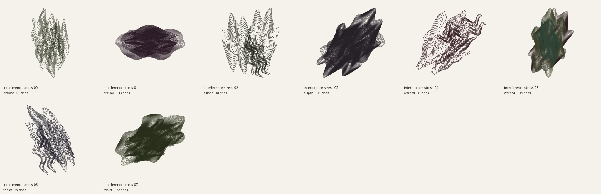

# Interference review

Interference produces moiré art by superposing two or three seeded families of analytic rings. Invertible sinusoidal shears, reciprocal ellipse scaling, rotation, detuning, phase, and irregular layouts provide controlled variation. The [generator reference](../src/generators/interference/README.md) documents every parameter, the inverse map and its Jacobian, the connection to primary moiré papers, sampling tolerances, and model limits.



| Elliptic: seed 00 | Triplet: seed 01 |
| --- | --- |
|  |  |

| Near-circular: seed 03 | Warped: seed 16 |
| --- | --- |
|  |  |

## Recorded 48-seed audit

`interference-review-00` through `interference-review-47` were rendered through the application's actual line-preview renderer at 1200×1200 pixels.

| Measurement | Recorded result |
| --- | --- |
| Unique SVG hashes / unique PNG hashes | 48 / 48 |
| Families | 9 circular, 13 elliptic, 9 warped, 17 triplet |
| Rings per painting | 51–139 |
| Sampled vertices per painting | 4,188–12,855 |
| Smallest nominal fitted pitch per painting | 5.99–12.30 page units |
| Actual rendered ink coverage | 12.37%–32.26% |
| Pixels touching the image edge | 0 across all 48 |
| Generation time | Mean 15.6 ms; maximum 29.5 ms |
| SVG size | Mean 135 KB; maximum 220 KB |

The contact sheet shows differences in source overlap, orientation, density, ellipticity, radius balance, and nonlinear deformation. Full-size seed 16 exposes the smooth warped carriers beneath the apparent large-scale bands. Intersections between different sources are intentional. The finite ring families stop at their own computed boundaries; none is cropped by the page.

The `minimumPitch` metric in the report is nominal radial spacing after final uniform fitting. It is not a guarantee of Euclidean clearance after shear/ellipse compression, nor a measure of visible white gaps between strokes. Default `circular` sources have slight per-source aspect variation and should be read as near-circular compositions. The exact circular/equal-pitch hyperbola relationship is tested separately in a constructed analytic limit.

## Extreme controls



Eight deterministic `--extremes` cases vary the families while combining extreme source radius, pitch, detune, separation, aspect, warp, frequency, line width, layout jitter, and radius variation. Their exact overrides and resolved source-independent controls are recorded in the [extreme report](previews/interference-extremes-report.json).

All eight SVGs and rendered PNGs are unique, with zero pixels at the image edge. Actual ink coverage spans 13.76%–36.44%; mean generation was 47.8 ms, maximum 78.4 ms, and the largest SVG was 742,785 bytes. These timings are observations on the development host rather than browser-wide guarantees.

The densest configurations intentionally combine maximum line width with minimum pitch and three strongly warped sources. Some regions look nearly solid in a thumbnail. The carrier geometry remains meaningful, but this combination is less open and airy than the default artwork. It is a documented aesthetic and sampling limit, not hidden by reducing the requested controls. Larger raster output or direct SVG inspection is needed to judge the individual lines.

## What the tests establish

Six generator test groups verify inverse round trips, a unit Jacobian at maximum warp, polygonal-area convergence, analytic carrier indices, the exact circular-source hyperbolic fringe identity, 48-seed diversity and margins, reproducibility, continuous parameter response, invalid-input rejection, and eight joint-extreme configurations. The entire branch's `npm test` run passed 59 tests in 8.1 seconds after the layout/radius-variation controls were included.

The area check compares a sampled warped ring with the area of its original circle, since the analytic deformation preserves area. The fine chord tolerance improves that approximation and keeps the tested relative area error below .1%. The finite-difference determinant check tolerates `1e-4`, while inverse round trips are below `1e-10`. These are specific numerical assertions, not a proof that every tessellated curve has a globally bounded Hausdorff error.

The underlying map is invertible, so distinct analytic rings of one source cannot fold into each other. Drawn polyline vertices also satisfy their analytic ring indices. Cross-source overlaps are the purpose of the design. Tests and raster audits distinguish these intentional intersections from clipping, nonfinite geometry, or source-map folding.

The production build passed. Chromium checks passed on desktop and at 390×844 portrait, 844×390 landscape, and 320×568 narrow-phone sizes. These covered seed reload/history, a revision upgrade regenerating exactly once, paper and transparent PNG downloads with pixel/alpha checks, and SVG/PDF downloads. Additional inspection of dense seed 03 and warped seeds 15/16 at phone scale and 3200-pixel output found coherent carrier fringes; fine texture changes naturally with resampling.

## Reproduce and inspect

```sh
node --test tests/interference.test.mjs
node scripts/art-review/interference.mjs --count 48 --out /tmp/interference-review --raster --width 1200
node scripts/art-review/interference.mjs --extremes --out /tmp/interference-extremes --raster --width 1200
```

The [default report](previews/interference-report.json) and [extreme report](previews/interference-extremes-report.json) retain exact seeds and parameters, SVG and PNG hashes, timing, byte counts, geometric metrics, pixel coverage, and bounds. Regeneration writes full SVG/PNG specimens and contact sheets. The committed JPEGs are review artifacts; live paintings remain procedural vectors generated on demand.

The primary indicial moiré model explains fringe geometry, not brightness or the most prominent perceived fringe order. This implementation performs no FFT and solves no wave PDE. Stroke thickness, output resolution, downsampling, and the display affect visible contrast and aliasing, especially in thumbnails. The browser/export checks complement these mathematical and raster audits without adding a physical intensity model.
