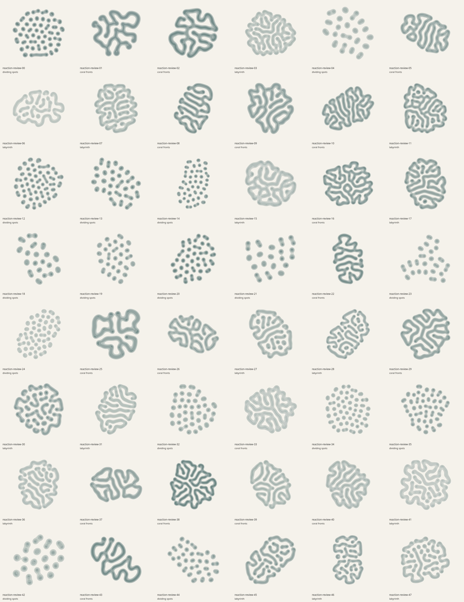
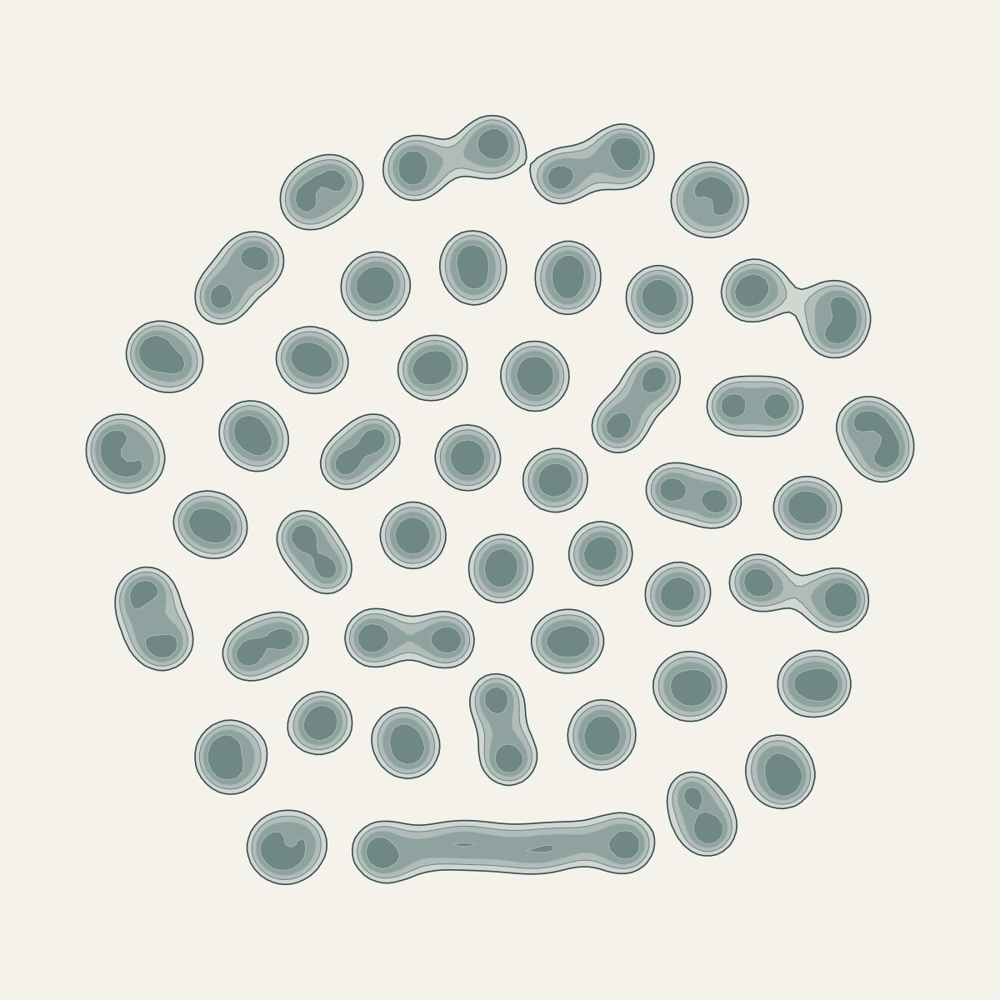
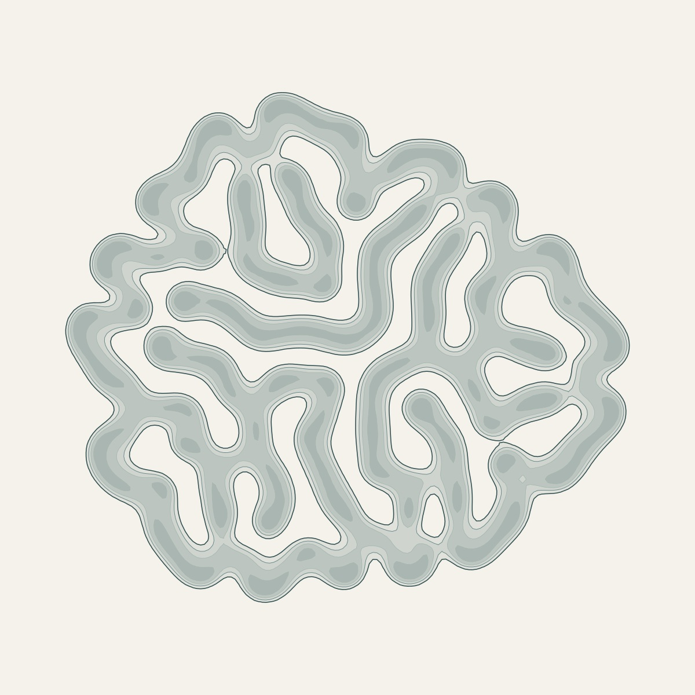
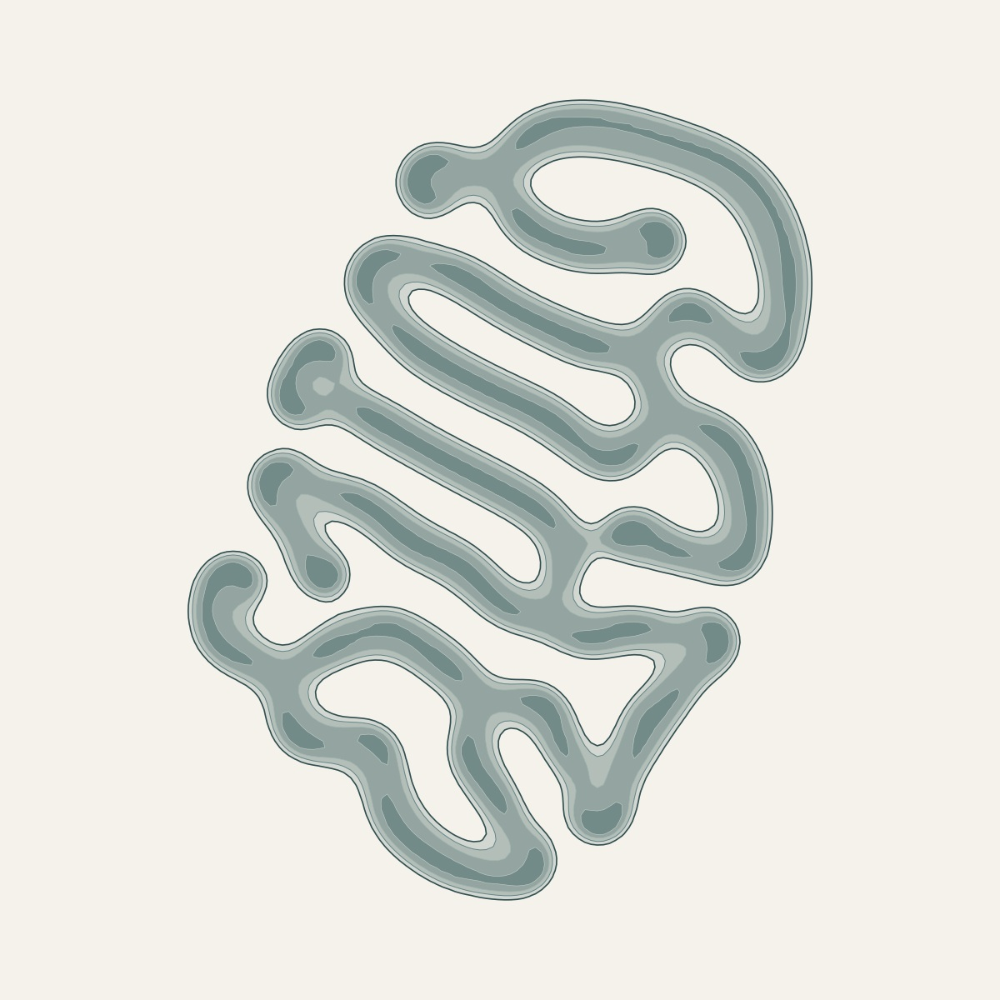

# Reaction Fields review

The generator evolves the Gray–Scott equations from seeded finite perturbations, then exports concentration bands as compound vector paths. Feed, kill, diffusion, integration time, initial nuclei, clustered layout, environmental gradient, contour levels, and ink are explicit controls. [Model, primary papers, API, and supported ranges](../src/generators/reaction/README.md).



| Spotted colony | Labyrinth | Coral-like fronts |
| --- | --- | --- |
|  |  |  |

## Recorded batch

`reaction-review-00` through `reaction-review-47`, at 1200-pixel review resolution:

- 48 distinct SVG hashes and 48 distinct rendered PNG hashes.
- 16 seeded spotted neighborhoods, 17 coral-front neighborhoods, and 15 labyrinth neighborhoods; all three initial cluster counts represented.
- No nonfinite concentrations, clipped-edge pixels, open contours, or self-crossing contour loops. Minimum and maximum active field fractions were 6.10% and 31.92%; no blank or saturated pattern.
- Mean generation 2.66 seconds, maximum 3.56 seconds on the shared development machine while other style work ran. Mean SVG 104 KB; maximum 162 KB. These are measured desktop results, not a latency guarantee on phones.
- 23 simulations stopped at the boundary guard; actual integration time was at least 1296 numerical units. The maximum guard-band concentration was .0342, below the lowest displayed contour level. Every output retained the requested page margin.

I inspected the full contact sheet and full-size examples, including tightly approaching fronts and holes. The final batch has clean, connected fronts and distinct colony densities and silhouettes. Local necks can be very narrow as real simulated fronts approach one another; the contour polylines do not cross. The palette is deliberately restrained, with an outline-only option. The art has a recognizable common chemical style rather than 48 unrelated drawing recipes.

Earlier drafts had pale outlines, broad repeated worm scales, and excessive expansion toward the square boundary. Refining the kinetic neighborhoods, varying initial clusters and diffusion scales, introducing the guard stop, and using correctly wound filled concentration bands addressed those issues. No decorative noise or replacement geometry was added.

## Numerical and stress checks

The test suite verifies the unchanged `(1,0)` equilibrium; diffusion mass conservation and maximum principle; autocatalytic transfer of mass from `u` to `v`; quarter-turn covariance; first-order temporal convergence; locally continuous response to feed changes; finite nonnegative fields at supported rate extremes; and correct opposite winding for a synthetic annulus. All 48 default fields and path sets are unique, developed, closed, simple, and within margins. Rendering controls leave the chemical fields unchanged. The bundled classic worker reproduces the source SVG and parameter metadata for a Unicode seed.

An additional independent stress run covered eight new seeds and six control studies: a 224² grid, a `.2` time step, three sparse nuclei, 24 elongated nuclei in three separated clusters, and lowest/highest contour thresholds. All retained finite nonnegative concentrations and closed bounded contours. The largest study (`reaction-stress-largest`, 224², duration 2600, step .75) took 4.26 seconds for approximately 174 million requested cell updates. Peak process RSS across the whole 14-case sequence was 130 MB; this includes the JS runtime, contour objects, and arrays awaiting collection. The generator rejects work requests above 180 million cell updates. The largest-grid and refined-step cases are permanent regression tests.

Arbitrary overrides can produce chemical extinction or uninteresting regimes. This is reported explicitly when no contour survives; there is no hidden parameter retry. Spatial discretization still introduces some directional bias, and only short-time temporal convergence is tested: the long-time patterns are not claimed to be grid-converged physical predictions. Pearson's model is implemented; the Lee et al. experiment and Hagberg–Meron front analysis are related inspiration, with different chemistry/equations. The [generator README](../src/generators/reaction/README.md#model-and-papers) links the actual papers and states that distinction.

## Reproduce

```sh
node --test tests/reaction.test.mjs tests/isocontours.test.mjs
node scripts/art-review/reaction.mjs --count 48 --out /tmp/reaction-review --raster --width 1200
```

The review directory contains every SVG and PNG, a full contact sheet, and `report.json` with exact parameters, hashes, timings, concentration statistics, and actual preview-renderer pixel bounds. Committed JPEGs above are review artifacts; live drawings are generated from their seed and cached locally, without bundled stock images.

## Application integration

The full repository suite passed (68 tests), followed by a production build and Chromium browser verification. Checks cover desktop and 390×844, 844×390, and 320×568 phone layouts; correct image proportions; seed reload and history; exactly one regeneration of an outdated cached revision; 3200-pixel PNG exports with paper and transparency; and SVG/PDF downloads. PNG checks decode pixels to verify visible artwork, page ratio, opaque paper, and transparent margins.

[Browser results](previews/reaction-browser-results.json) and [48-seed parameters, hashes, and measurements](previews/reaction-report.json) are committed alongside the gallery. [Additional stress results](previews/reaction-stress-report.json) record the larger parameter study. Run `npm test`, `npm run build`, then `node scripts/check-browser.mjs` to reproduce. The browser script needs Playwright/Chromium; the optional raster review needs Cairo `canvas` and `path2d`. These verification tools are not application runtime dependencies.
