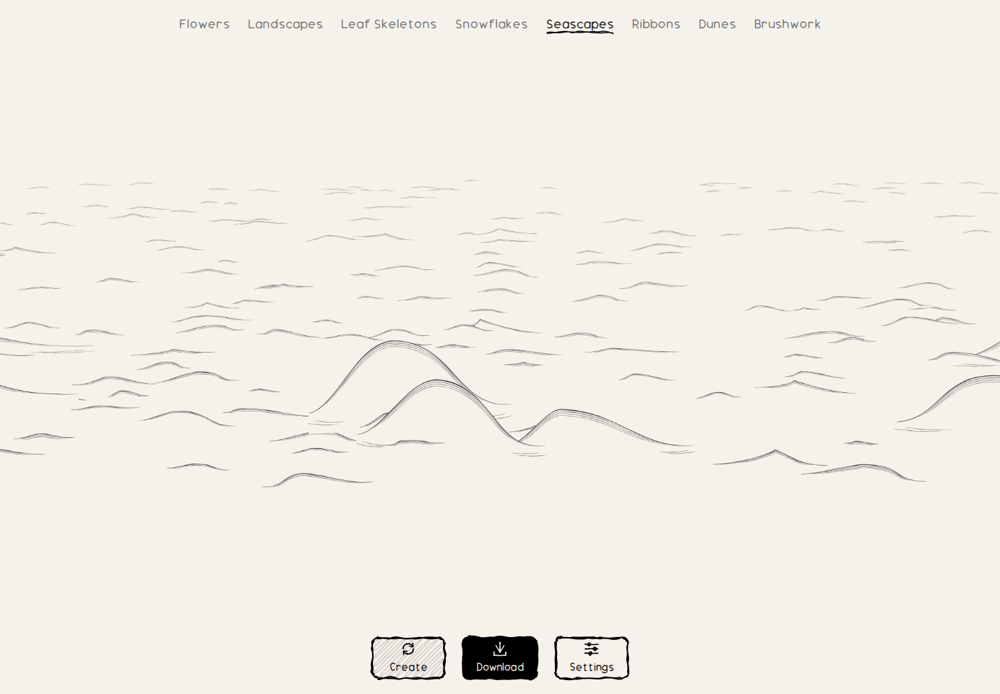
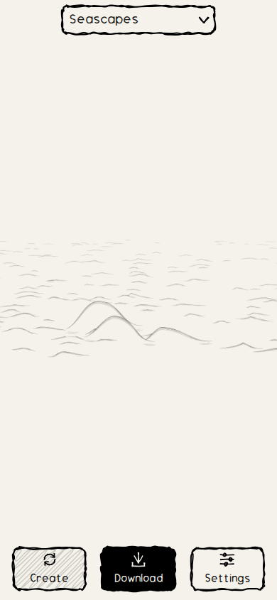
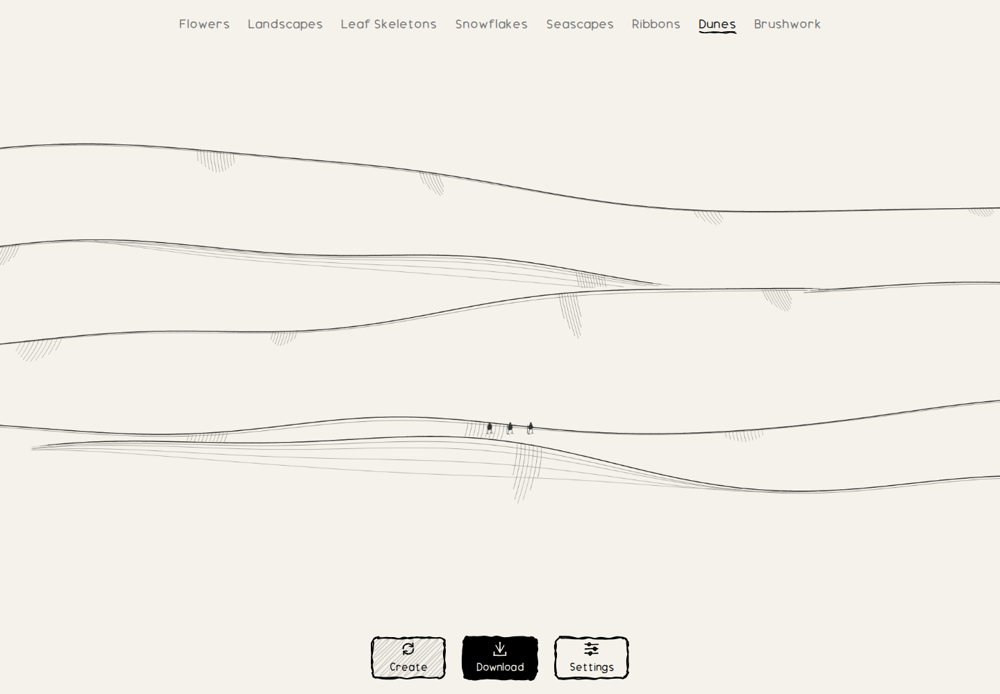
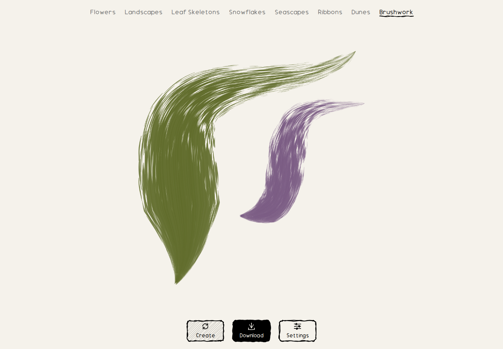

# Gallery refinement review

The gallery now contains eight styles: Flowers, Landscapes, Leaf Skeletons,
Snowflakes, Seascapes, Ribbons, Dunes and Brushwork. Folds and Interference
have been removed from the navigation, registry, generated routes, workers,
source, dedicated tests and current documentation. Cityscapes and Houses
remain retired.

Original styles display no credit or date beneath the website navigation.
Flowers and Landscapes retain Lingdong Huang's attribution and publication
dates, including in their generated static pages. Upstream licenses and
research references remain in the repository.

## Changes to the drawings

| Style | Revision | Result and detailed evidence |
| --- | ---: | --- |
| Seascapes | 5 | Broad crests, short falling lips and sparse marks replace the elaborate hooked sheets, dark bands and branching foam. The 48-seed fleet averages 1.79 boats. [Before/after, equations, controls and full/crop galleries](seascapes-review.md). |
| Dunes | 3 | A genuinely wider continuous field with several correlated ridge peaks and tiny grounded walkers/camels, composed for both the panorama and central crop. [Parameters, geometry tests and galleries](dunes-review.md). |
| Snowflakes | 2 | Growth-phase outlines are omitted. Side ridges are restricted to narrow branches so broad plates no longer acquire a hexagonal web; the cellular growth history and final outline remain unchanged. [Model and 48-sample review](../src/generators/snowflakes/README.md). |
| Brushwork | 2 | Ten seeded pigment pairs plus continuous hue/saturation controls. All 48 reviewed drawings retain revision 1 path coordinates exactly. [Color equations, galleries and transparent-export checks](brushwork-review.md). |

The [README sample gallery](../README.md#samples-of-every-style) contains two
outputs per retained style, generated through the shipping browser workers.
The [sample manifest](samples/manifest.json) records all 16 seeds, revisions,
source/print dimensions and JPEG hashes. These are procedural outputs, not
illustrative mockups. Full panorama images accompany the six wide samples.

## Shared panorama and print behavior

Landscapes, Seascapes and Dunes use the same contract:

- Source geometry: **3200×800**; desktop preview: **4096×1024**.
- Print metadata: `width = 800 * Math.SQRT2`, `height = 800`, `previewWidth = 3200`.
- Desktop framing spans beyond the viewport and supports horizontal panning.
- Phones and narrow windows show the centered √2 landscape crop.
- PNG, SVG and PDF use that same fixed central crop, independent of panning.
- Cropped and full previews have separate cached blobs; changing view size
  does not regenerate the drawing. Old artwork revisions regenerate the same
  saved seed once, then reuse the updated cache.

Both SVG and Canvas apply the same central translation before rendering.
Source geometry is extended with new terrain/water at the sides; the original
compact scene is not stretched. Full-source audits reject ink touching any
edge. Print-crop audits permit horizontal crossings of continuous terrain or
water, while rejecting top/bottom clipping. Boats and dune figures remain
fully within their central crop.

## Visual and numerical audits

| Changed style | Default seeds | Extra stress cases | Raster checks |
| --- | ---: | ---: | --- |
| Seascapes | 48 | 8 | Unique full/crop images; no unintended clipping, blank or saturated outputs. |
| Dunes | 48 | 8 | Unique full/crop images; grounded figures and clear source margins. |
| Snowflakes | 48 | — | Four habits; unique images; clear margins; retained connected, sixfold geometry. |
| Brushwork | 48 | 8 | All ten palettes; clear margins; 8 additional paper/transparent export comparisons. |

This is **192 default drawings plus 24 stress drawings**. Committed contact
sheets and per-seed JSON reports are linked from each model's review. Geometry
tests supplement visual inspection; a hash establishes distinctness, not
artistic quality. Optional ochre dunes remain slower than the default ink
renderer, and crowded stress routes may place fewer travelers than requested
to preserve visibility and spacing.

## Browser and integration evidence

**All 122 repository tests and the production build pass.** The Chromium
suite passes every retained style in one desktop/mobile navigation session,
then checks each of the six original generators independently:

- Direct seed links, Create/back history, cache reload, one-time revision
  upgrades and preservation of the saved seed.
- Desktop framing and three phone dimensions, with credits/dates visible
  only for the two adapted engines.
- Desktop-to-phone-to-desktop panorama changes without regeneration.
- SVG, PDF and 3200-pixel PNG downloads; visible ink, correct aspect ratio,
  opaque paper and transparent margins.
- Keyboard panning of the wide scenes, followed by byte-identical SVG
  exports of the fixed center crop.
- No browser errors or failed artwork/resource requests. All four retired
  routes return 404; their workers and cached assets are absent.

[Recorded navigation](previews/refinement-navigation.json) and
[download results](previews/refinement-browser-results.json) preserve the
checked seeds and file sizes.

| Desktop panorama | Phone print crop |
| --- | --- |
|  |  |





## Reproduce

```sh
npm ci
npm test
npm run build
npm install --no-save --package-lock=false playwright@1.58.2
npx playwright install chromium
node scripts/check-browser.mjs
node scripts/readme-samples.mjs
node scripts/check-browser.mjs --url=https://hectorrguez.github.io/painting-prints/
```

Run test/build sequentially because both prepare workers. The browser suite
writes local evidence to `.artifacts/browser/` and live-site evidence to
`.artifacts/deployment/`. The sample script writes only documentation images
and metadata. Optional Canvas/Path2D review commands are in each generator's
README.
