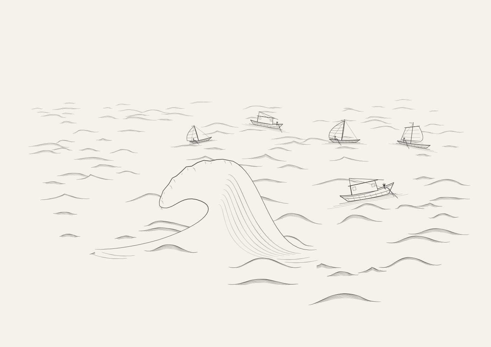
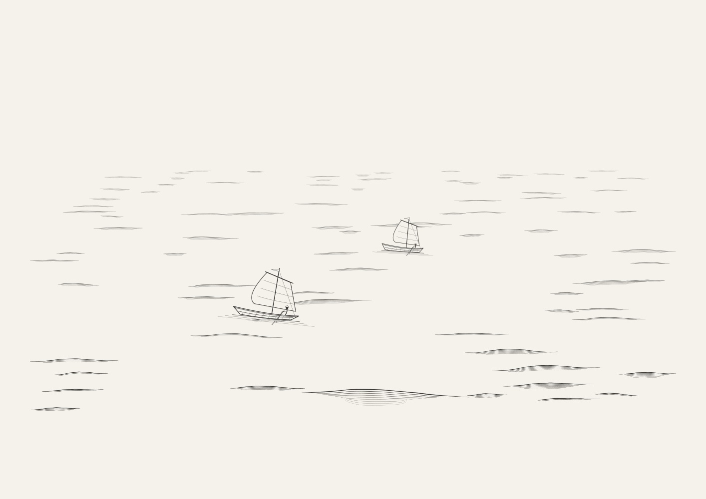
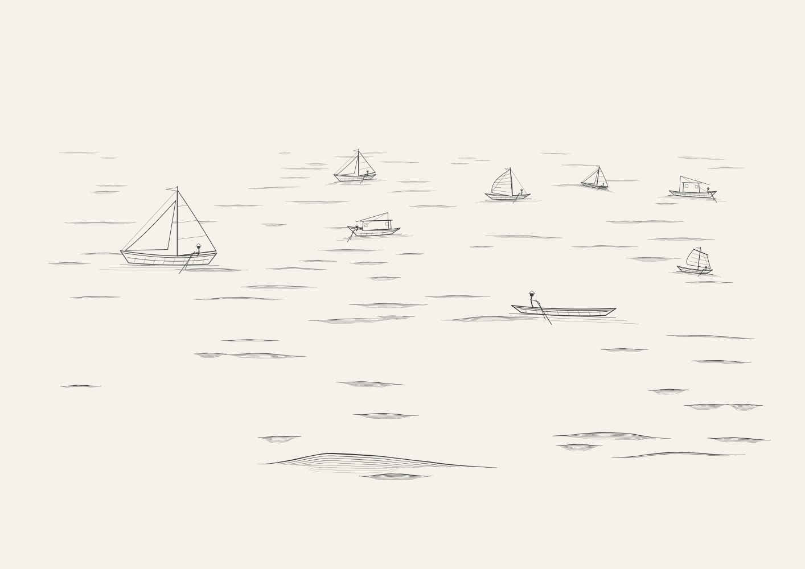
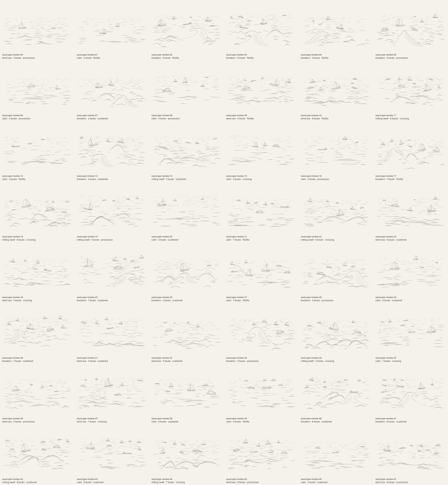

# Seascapes: expanded waves and fleets

Revision 2 adds calm water, wind chop, rolling swells and occasional large
foreground breakers, with two to eight boats from six procedural families.
These are renders of the generator through the app's actual line renderer.

## Large foreground wave

Seed `seascape-review-33` combines an overhanging crest with five boats.
The illustrated curl is distinct from the non-overturning water field that
positions the boats. Large-wave seeds vary the curl opening, reach, shoulder,
foam edge and placement; other rough scenes use spilling crests.

## Calm water and larger fleets

Seed `seascape-review-01` keeps a quiet composition with two luggers.

Seed `seascape-review-43` shows an eight-boat fleet with different rigs and hulls.

## All 48 reviewed seeds

The batch has 48 distinct SVG hashes and 48 distinct PNG hashes. Sea states:
15 calm, 11 wind sea, 8 rolling swell, and 14 breakers. Boat counts range from
two to eight; 25 scenes contain at least six boats. Across the 262 vessels,
there are 42 battened sailboats, 45 cutters, 35 luggers, 49 sampans, 42 skiffs
and 49 fishing boats. All four arrangement families appear. The largest crest
amplitude is 241.81 canvas units; generation took at most 142.12 ms in this
local audit, excluding rasterization.

All 48 scenes passed finite-coordinate and margin checks, boat collision and
waterline checks, full boat-geometry containment within placement bounds, and
foreground-wave clearance. An independent 128-seed review found 128 distinct
drawings, no vessel clipping/collisions, and no self-intersection in its 643
hull masks. A separate 128-seed audit found no intersecting major wave contours.
The tiny irregularities of ink marks are intentional; these are illustrative
seascapes, not calibrated ocean simulations.

Reproduce the batch and its JSON metrics with the commands in the
[generator documentation](../src/generators/seascapes/README.md#reproduce-the-review).
The final review also includes browser tests for seed links, cached art and
PNG/SVG/PDF exports through the app.
