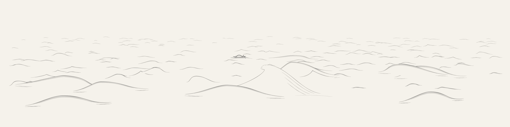
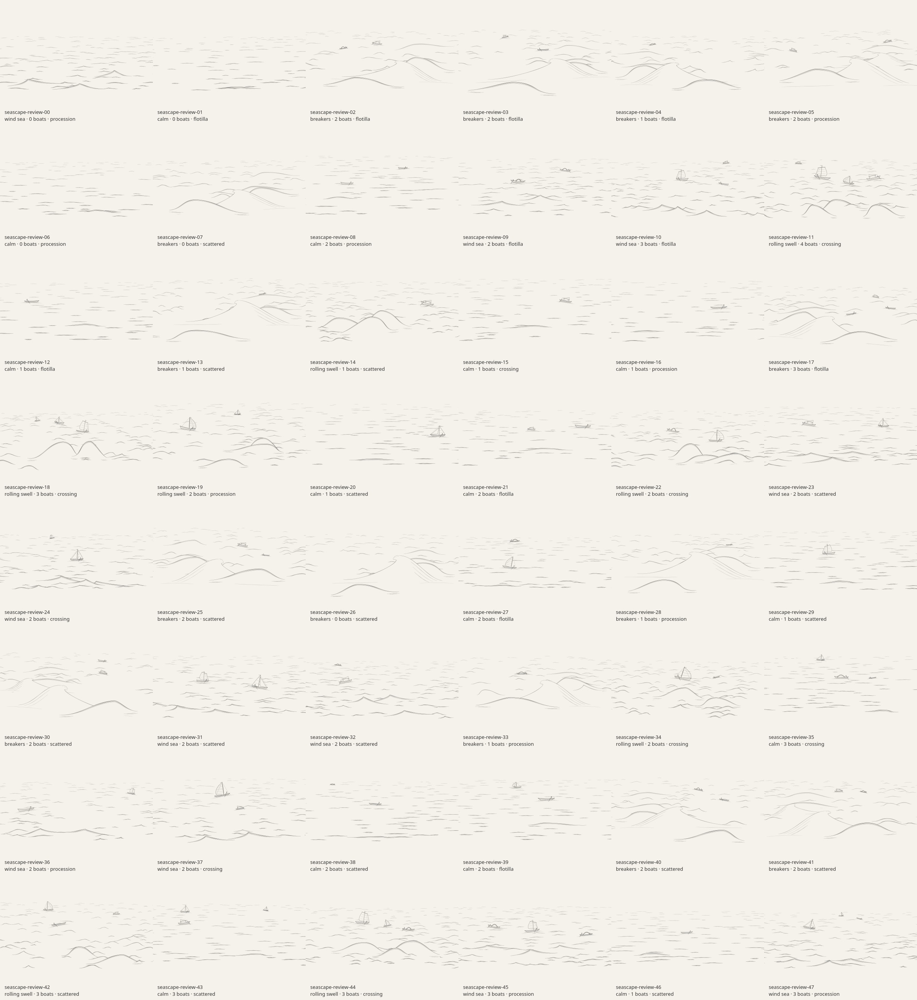
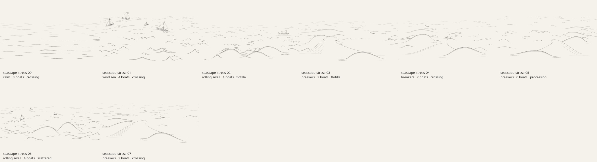

# Seascapes: simpler waves and a real panorama

Revision 5 replaces the elaborate curled sheet with a broad shoulder, short
falling lip, open face and a handful of marks. Dense hatching, dark ribbons,
branching foam and detached spray are removed. The source now spans
**3200 × 800**, with independently generated water at both sides and a
centered **800√2 × 800** print crop, matching Landscapes. The sparse fleet and
main wave remain inside the print composition.

All images below use the actual line renderer and white-to-alpha masking.
The [generator README](../src/generators/seascapes/README.md) documents the
Gerstner supporting surface, simple cubic sheet, units and changed controls.

## Same seed before and after

Both images use `seascape-review-33`, with one small working boat. The former
image is the committed revision 4 output; the new one is the center print crop.

| Revision 4 | Revision 5 |
| --- | --- |
|  |  |

The complete generated panorama contains different side-water geometry:



Its central print crop is:


The previous Kanagawa reference now informs only the sweeping rise and short
forward lip. This is a stylized geometric illustration, not a traced image or
physical simulation of breaking water.

## All 48 seeds, in both formats




The batch contains **86 boats, averaging 1.79 per scene**. Five scenes are
intentionally empty. Breaker scenes average 1.5 small working boats.

| Boats | Scenes |
| --- | ---: |
| 0 | 5 |
| 1 | 11 |
| 2 | 22 |
| 3 | 9 |
| 4 | 1 |

Coverage includes 15 calm scenes, 11 wind seas, eight rolling swells and 14
breakers. All six families appear: 22 skiffs, 18 fishing boats, 16 sampans,
10 cutters, nine luggers and 11 battened sailboats. All four arrangements occur.
Vessel placement accounts for the central crop, so panning the panorama does
not determine the boats included in the exported print.

Seed 01 is a calm empty sea; seed 43 retains three vessels at different depths.


## Eight parameter extremes

The stress set covers empty water, four requested vessels, minimum/maximum
roughness and steepness, opposing directions, horizon and boat-size limits,
minimum/maximum lip/curl controls, and zero/maximal foam strokes. At the upper
lip bounds the small notch is more pronounced, but it cannot grow back into
the previous large tube or dense foam structure.




All **56 source SVGs, 56 full PNGs and 56 crop PNGs** are globally unique in
this combined review. No full-source edge clipping, vertical crop clipping,
blank scenes or saturated images were found. Horizontal water lines may cross
the print crop edges intentionally; every boat remains wholly inside.

Default source drawings contain 626–1190 paths and 808–1491 kB of SVG
(1175 kB mean). Measured ink coverage is 1.91–3.16% in panoramas and
1.85–3.51% in print crops. The largest crest rise is 223.67 logical units,
or 178.94 source units. Generation averaged 251 ms, maximum 390 ms on the
review machine while other local checks were running; other devices differ.

## Validation

Fourteen targeted tests pass:

- Determinism, immutable inputs, validated overrides and preservation of
  unrelated seeded values.
- Continuous controls, 64 combinations of silhouette bounds, 64 additional
  seeded shapes, and simple connected water-sheet outlines.
- 128 sparse-stroke containment checks, tiny lip limits and absence of filled
  ink ribbons; air-opening foam clipping.
- All 48 scenes with finite geometry, clear source margins, independent side
  water, deliberately composed centers, wholly contained vessels, correct
  surface attachment, limited roll and collision/foreground-wave clearance.
- Analytic Gerstner tangent/inversion checks, sparse fleet distributions,
  extreme parameters, cache/shared links, centered SVG export and exact
  classic-worker SVG/parameter parity.

Both complete contact sheets and their stress versions were visually reviewed.
Full-size seed 33, seed 25, seed 11 and extreme 03 were also inspected for
silhouette, masking and vessel overlap. Geometry tests alone do not establish
visual quality. The sheet remains a stylized construction; it does not model
water transport, wave impact or vessel dynamics.

## Reproduction and records

```sh
node --test tests/seascapes.test.mjs tests/breaker.test.mjs
node scripts/art-review/seascapes.mjs --count 48 --raster --out /tmp/seascape-review
node scripts/art-review/seascapes.mjs --stress --raster --out /tmp/seascape-stress
```

The [48-scene report](previews/seascapes-report.json) and
[eight-scene stress report](previews/seascapes-stress-report.json) contain
resolved logical-world and breaker parameters, boat geometry, source/full/crop
hashes, timing, and separate panorama/crop pixel bounds. Raster review uses
optional native `canvas` and `path2d`; these are not runtime dependencies.

The combined refinement passes all 122 repository tests, the production build and Chromium desktop/mobile/cache/export checks. [Integration evidence](refinement-review.md) and [current Seascapes browser report](previews/seascapes-browser-results.json).
