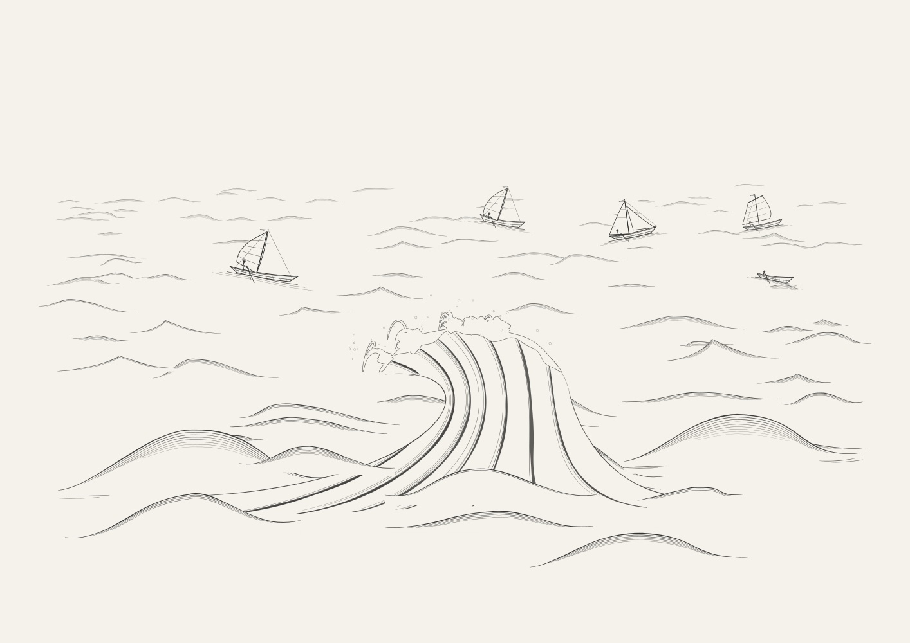
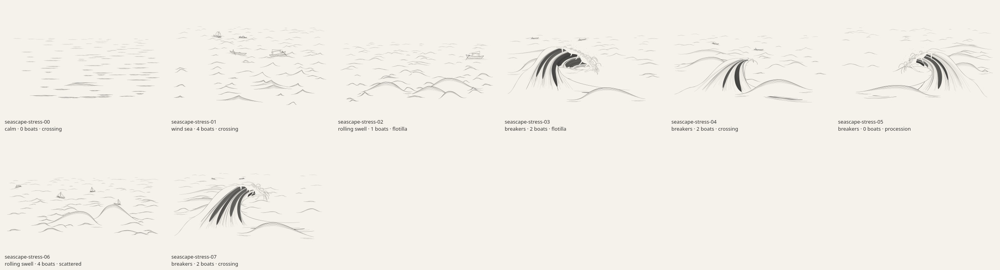

# Seascapes: sweeping waves and smaller fleets

Revision 4 redraws the Kanagawa-inspired crests as asymmetric rising shoulders,
pointed lips and concave returning faces. Long neighboring swells connect them
to the foreground. Tapered dark water ribbons, fine curved hatching and thinner
forked foam give the face more weight while retaining generous open space.
All specimens use the application's actual line renderer.

The art reference is Hokusai's
[Under the Wave off Kanagawa](https://www.metmuseum.org/art/collection/search/45434).
These are seeded geometric illustrations, not traced images or calibrated
simulations of breaking water. The
[generator documentation](../src/generators/seascapes/README.md) explains the
Gerstner supporting surface, separate drawn overhang, equations and controls.

## Same seed before and after

Both images use `seascape-review-33`. The previous output has five prominent
boats; the new scene has one small working boat in the distant clear water.

| Previous output | Revision 4 |
| --- | --- |
|  |  |

The new full-size hero makes the fine hatching, negative foam shapes and
longer surrounding swells easier to inspect.


## All 48 reviewed seeds


The same first 48 seed identifiers contain **85 boats, averaging 1.77 per
scene**, compared with 263 boats and 5.48 per scene in the previous review.
That is 68% fewer vessels in this batch. Empty seas are intentional. Storm
scenes average 1.43 small working boats; tall sailing rigs remain available
in the other sea states.

| Boats in a scene | Number of scenes |
| --- | ---: |
| 0 | 6 |
| 1 | 10 |
| 2 | 22 |
| 3 | 9 |
| 4 | 1 |

Sea-state coverage is 15 calm scenes, 11 wind seas, 8 rolling swells and
14 breakers. All six boat families appear: 20 skiffs, 21 fishing boats,
12 sampans, 11 cutters, 9 luggers and 12 battened sailboats. All four placement
arrangements occur. The largest crest amplitude is 348.58 canvas units.

Seed `seascape-review-01` demonstrates an empty calm sea.


Seed `seascape-review-43` retains three distinct vessels at different depths.


## Extreme controls

Eight additional scenes exercise empty water, maximum requested boats,
low/high roughness and steepness, both orientations, boat scale, horizon,
low/full curl, shoulder entry, lip projection/drop, hollow depth, dense foam
and no spray. The extreme low-curl example intentionally becomes a spilling
crest with an open face.



All 56 SVG hashes and all 56 PNG hashes are globally unique. Raster checks
found no empty, saturated or edge-clipped drawings. The default batch uses
344–714 paths, 414–799 kB SVGs (564 kB mean), and 1.95–6.00% measured ink
coverage. Generation averaged 47.9 ms locally, with a maximum of 119.5 ms;
these timings describe the review machine rather than other devices.

## Validation

Thirteen generator tests pass, covering:

- Seed determinism, input immutability, validated controls and preservation of
  unrelated seeded values when overriding one parameter.
- Continuous silhouette changes, 256 combinations of shape-control bounds,
  64 additional seeded silhouettes and low-curl regressions.
- Simple ink ribbons whose edges remain inside the water sheet, with tapered
  clipped ends instead of disconnected dark fragments.
- All 48 default scenes, finite path bounds, sparse fleet probabilities,
  actual boat geometry within collision bounds, foreground-wave clearance,
  surface attachment and bounded roll.
- Supporting-surface coordinate inversion, analytic tangents and the
  non-overturning condition; extreme scene controls; cache/shared-link/vector
  export behavior; exact SVG/parameter parity with the bundled classic worker.

The full repository suite also passed all 65 tests, the production build and
Chromium checks for desktop/mobile layout, seed links, cache regeneration and
PNG/SVG/PDF exports. The [browser results](previews/seascapes-browser-results.json)
are included. The contact sheet, full-size breakers and stress gallery
were visually inspected separately from those checks.

The water sheet and foam remain stylized geometry. Supporting waves do not
physically evolve into the drawn overhang, and boat placement does not simulate
dynamics. Uniqueness is established for these reviewed seeds, not an infinite
set of possible outputs.

## Reproduce and inspect the records

```sh
node --test tests/seascapes.test.mjs tests/breaker.test.mjs
node scripts/art-review/seascapes.mjs --count 48 --raster --out /tmp/seascape-review
node scripts/art-review/seascapes.mjs --stress --raster --out /tmp/seascape-stress
```

The [48-scene JSON report](previews/seascapes-report.json) and
[eight-scene stress report](previews/seascapes-stress-report.json) retain exact
resolved sea and breaker controls, boat geometry, hashes, timing and pixel
bounds. Raster review requires optional local `canvas` and `path2d` packages;
they are not runtime dependencies.
