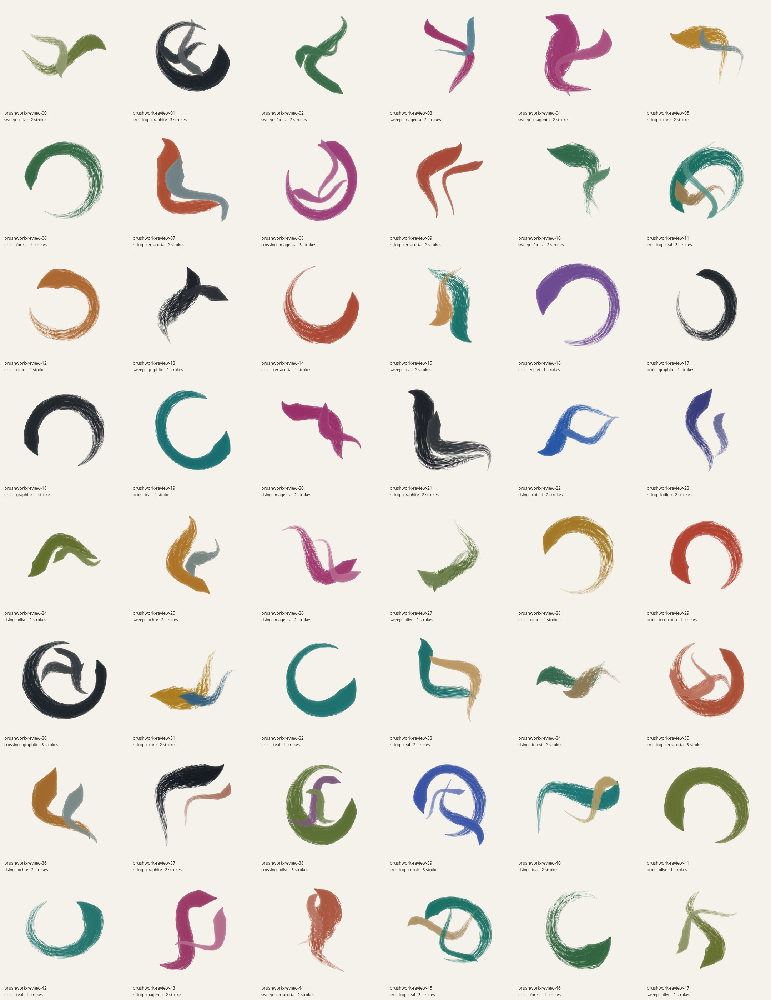
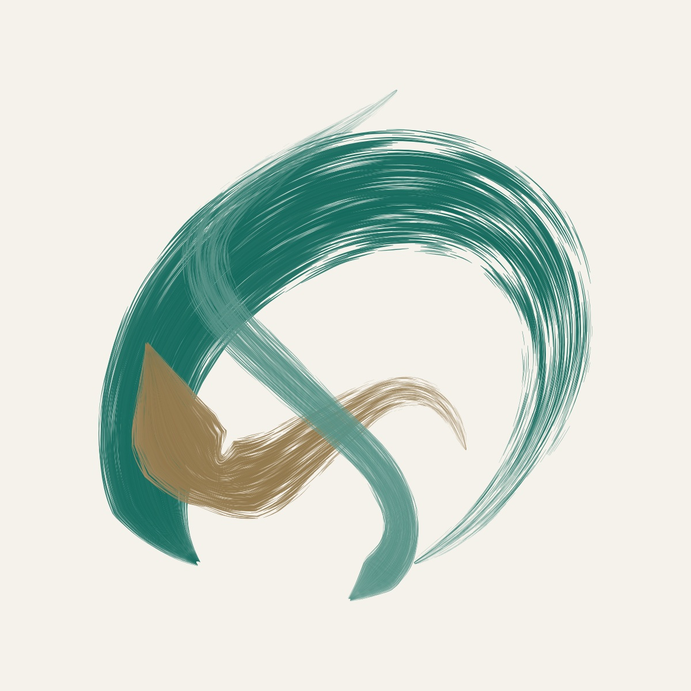
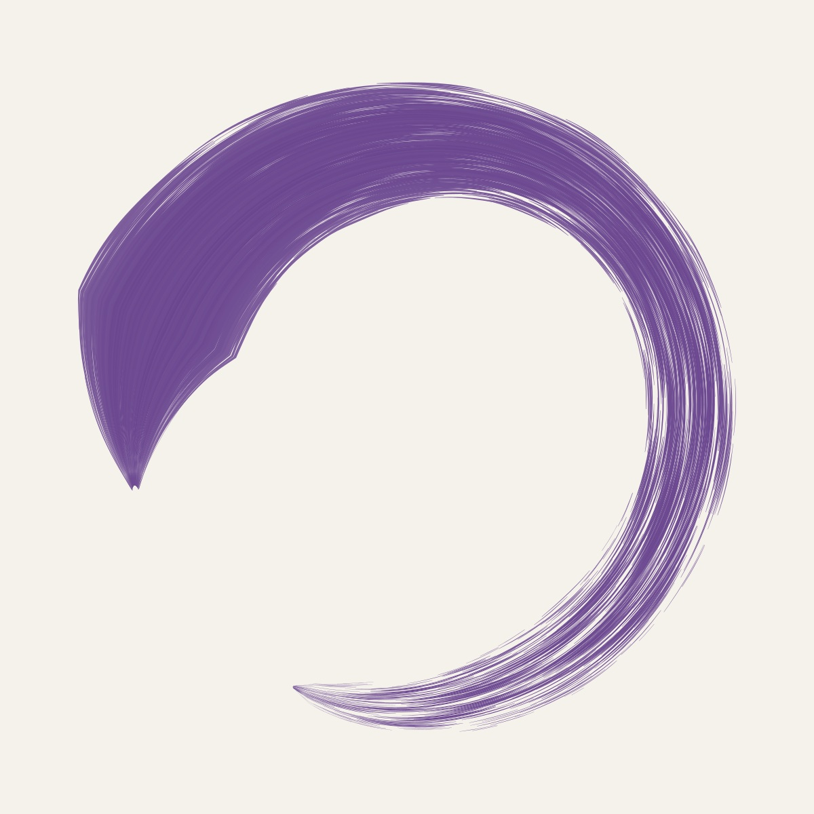
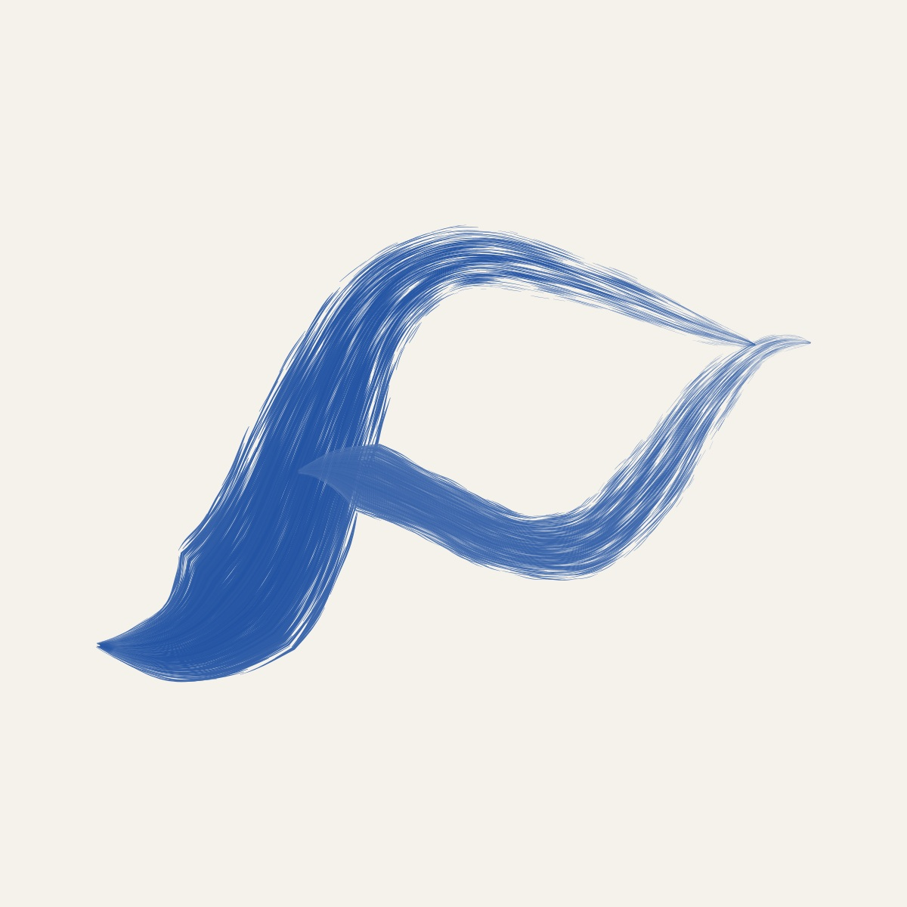
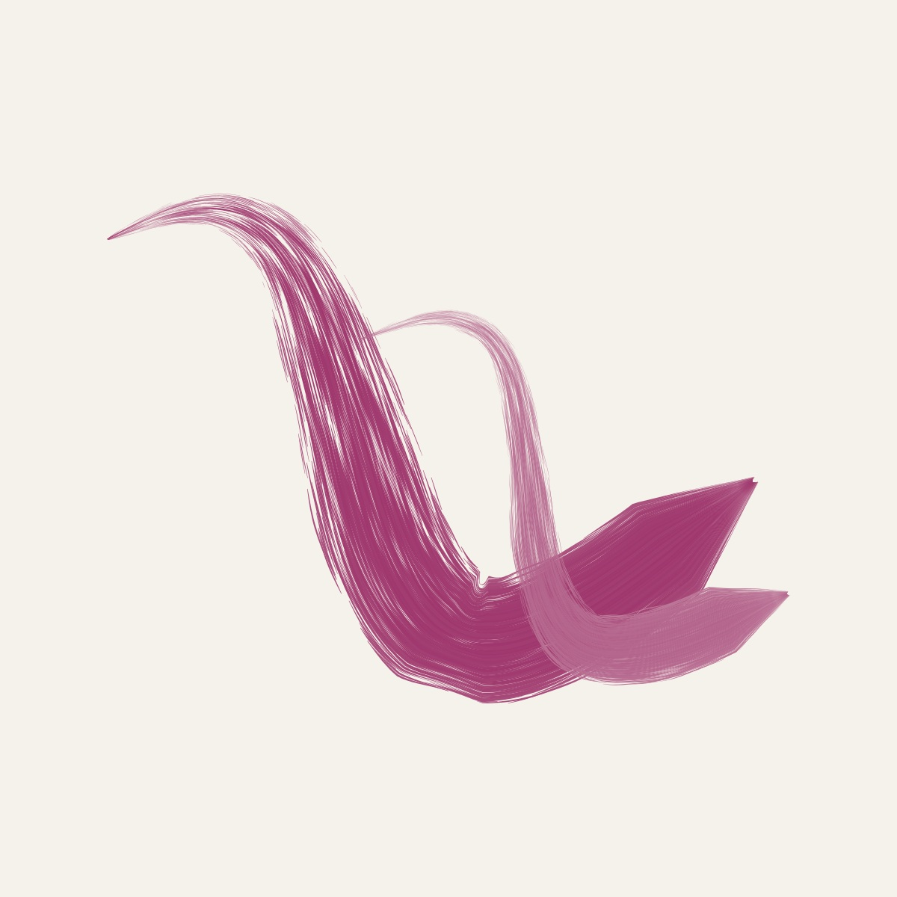

# Brushwork

Brushwork draws pressure-shaped gestures from individual bristle contacts.
Broken circles, broad bends and crossing strokes share a dry-brush texture.
Revision 2 adds ten ink palettes and continuous hue/saturation controls while
preserving the existing seed-to-geometry mapping.



## Color model

Colors use a separate seeded stream, `${seed}:brush-colors`. It never consumes
the trajectory, composition or bristle streams. Changing `palette`, `hueShift`
or `saturation` leaves every pressure sample, centerline, fiber polygon,
contact gap and page placement unchanged.

| Palette | Primary ink | Counterstroke |
| --- | --- | --- |
| `graphite` | `#11171d` | `#8f3424` |
| `indigo` | `#292e6f` | `#ab7123` |
| `cobalt` | `#234da1` | `#ae6627` |
| `teal` | `#106c69` | `#b27725` |
| `forest` | `#245e3a` | `#a05e37` |
| `violet` | `#633a8e` | `#b76143` |
| `magenta` | `#942a64` | `#216678` |
| `ochre` | `#a5681d` | `#235873` |
| `terracotta` | `#a9472a` | `#20677e` |
| `olive` | `#586928` | `#6b4077` |

Defaults add a seeded hue shift of −7° to +7° and saturation multiplier of
.9–1.08. Both swatches are transformed in HSL: hue wraps through 360°,
saturation is multiplied and clamped to `[0,1]`, and HSL lightness is retained.
The explicit controls also support larger shifts and a neutral grayscale result.

The first secondary stroke uses `accent` to interpolate between the transformed
swatches; primary and later strokes use the primary swatch. A single-stroke
orbit can therefore be blue, green or violet without needing an accent stroke.
`accent: 0` means one palette color, not black.

For pigment amount `p`, bristle variation `v` and accent mix `a`:

```
rho = clamp(p * (1 - v), 0, 1)
ink = (1 - a) * primary + a * counterstroke
color = (1 - rho) * paper + rho * ink
```

The paper reference is RGB `(245,242,235)`. Variation combines a small seeded
amount with stronger edge lightening. Secondary strokes use .7–1 of the
requested pigment. These are display-RGB artistic mixtures, not physical
pigment or watercolor simulation.









## Geometry and research

Steve Strassmann's **Hairy Brushes** (SIGGRAPH 1986,
[DOI 10.1145/15886.15911](https://doi.org/10.1145/15886.15911),
[paper](https://www.cs.drexel.edu/~deb39/Classes/Papers/p225-strassmann.pdf)) and
the corresponding [MIT thesis](https://dspace.mit.edu/server/api/core/bitstreams/618d714e-613f-4863-9bc0-b67e4e38100f/content)
inspire the separation of brush, stroke, pigment application and paper models.
This implementation adapts the pressure-dependent bristle/contact abstraction.
It does not reproduce the complete kinetic model or simulate fluid transport,
absorption or pigment diffusion. The new palettes are an artistic extension.

Arc trajectories use

```
theta = start + extent*t
r = R * (1 + wobble*sin(2*theta + phase) + drift*(t - .5))
C(t) = (r*cos(theta), aspect*r*sin(theta)).
```

Sweeps use

```
C(t) = span * (t - .5, .23*bend*sin(2*pi*t + phase) + bias*(t - .5)^2).
```

Seeded translation and rotation place the curves. Analytic derivatives provide
the tangent, normal and curvature `cross(C',C'') / |C'|^3`. Pressure combines a
short attack, decaying release and low-frequency pulse. Half-width times
absolute curvature is limited to .75. Forward/backward arc-length propagation
limits half-width change to .5 units per unit traveled, avoiding abrupt notches.
Separate strokes may intentionally cross.

Bristles follow the moving frame with coherent roughness, stronger edge
irregularity and a small backward lag. A contact signal combines dryness,
stroke progress, lateral position and two oscillations. Losing contact ends a
filled polygon, exposing the background. Pressure and contact determine fiber
width. Ordinary opaque colors paint in stroke order, with antialiased edges.

Sampled edges are simplified using an explicit distance tolerance. A uniform
fit to an 850-unit square inside a 1000-unit page retains at least 75 units of
margin. There are no stored glyphs, traced silhouettes or raster textures.
The repository's 32-bit generator is finite; sample uniqueness does not imply
mathematically unlimited unique outputs.

## API and parameters

```js
import { brushParameters, buildBrushwork, generateBrushwork } from './generate.js';

const recipe = brushParameters('a-blue-gesture');
const painting = generateBrushwork('a-blue-gesture', {
  palette: 'cobalt', hueShift: -4, saturation: 1.1,
  family: 'crossing', accent: .85, dryness: .5,
});
```

`brushParameters(seed, overrides)` returns the complete primary recipe.
`buildBrushwork` exposes strokes, pressure frames, bristle geometry, page fit
and paths. `generateBrushwork` returns the SVG painting object with
`mode: 'brushwork'` and `artRevision: 2`. The project revision is also 2, allowing
the app to regenerate older saved seeds with their original shape and new
colors. Unknown controls, unsupported palettes, nonfinite numbers and invalid
ranges throw; zero values are respected.

| Control | Seeded default | Supported range | Effect |
| --- | --- | --- | --- |
| `palette` | equal selection | ten names above | Primary/counterstroke pair |
| `hueShift` | −7–7° | −180–180° | Rotate both pigment hues |
| `saturation` | .9–1.08 | 0–1.4 | Multiply HSL saturation; zero is neutral |
| `family` | equal selection | orbit, sweep, crossing, rising | Arrangement/trajectory |
| `width` | 110–190 | 24–220 | Primary width before pressure/fit |
| `dryness` | .32–.66 | 0–.85 | Contact loss toward trailing end |
| `bristles` | 100 | integer 40–160 | Fibers per stroke |
| `pressureVariation` | .18–.42 | 0–.65 | Pressure pulse amplitude |
| `taper` | .45–.85 | .4–1.8 | Release exponent |
| `bend` | .5–1 | .2–1.25 | Sweep bend amplitude |
| `sweep` | 4.7–5.75 radians | 3.6–6.05 radians | Arc extent |
| `radialWobble` | .025–.065 | 0–.12 | Radial harmonic deformation |
| `aspect` | .78–1.2 | .65–1.35 | Loop vertical scale |
| `rotation` | full turn | −π–π radians | Composition rotation |
| `roughness` | .3–.8 | 0–2.5 | Lateral bristle displacement |
| `pigment` | .92–1 | .35–1 | Ink density relative to paper |
| `accent` | 60% zero; otherwise .65–1 | 0–1 | First counterstroke's pigment mix |
| `strokeCount` | orbit 1; crossing 3; others 2 | integer 1–4 | Trajectory count |
| `scale` | .82–.97 | .65–1 | Occupancy of inset fit box |
| `samples` | 240 | integer 120–400 | Contact/curve sampling intervals |
| `chordError` | .1 | .02–.2 | Edge simplification tolerance |

Lengths refer to the unscaled construction plane. Secondary seeded values
include primary span 600–730/radius 235–290; secondary span 360–610/radius
130–200; secondary width .35–.72 of primary; radial drift −.1–.1; bend sign;
phases; contact frequency 5–12 cycles; and fiber width factor 1.35–2. These are
composition priors, not fitted measurements of a particular brush.

## Exports and verification

Transparent PNG/SVG exports retain the same pigment RGB values and leave the
background/contact gaps empty. They do not turn lighter ink into partially
transparent watercolor. Dark backdrops reduce contrast for darker inks. Color
controls preserve the complete alpha mask, including antialiased fiber edges.

The [review gallery and reports](../../../docs/brushwork-review.md) include 48
default seeds, eight joint color/geometry extremes and eight paper/transparent
comparisons. All 48 default path geometries were compared exactly with revision
1. Tests cover trajectories, curvature, pressure/width bounds, simplification,
contact loss, deterministic validated controls, all palettes, color algebra,
color-only geometry invariance, revision metadata, uniqueness and extremes.

```sh
node --test tests/brushwork.test.mjs
# Optional review tools, separate from runtime dependencies:
npm install --no-save --package-lock=false canvas@3.2.3 path2d@0.2.2
node scripts/art-review/brushwork.mjs --count 48 --raster --out /tmp/brushwork-review
node scripts/art-review/brushwork-stress.mjs --count 8 --prefix brushwork-stress --raster --out /tmp/brushwork-stress
node scripts/art-review/brushwork-exports.mjs --out /tmp/brushwork-exports
```

The review wrapper accepts `--overrides '{"palette":"violet","hueShift":12}'`
and `--width 3200` for print detail. Its Cairo shim runs the actual app renderer
and checks hashes, coverage and edge pixels. The export review checks opaque
paper, transparent margins, alpha-mask invariance and agreement between paper
rendering and compositing a transparent PNG onto paper.
