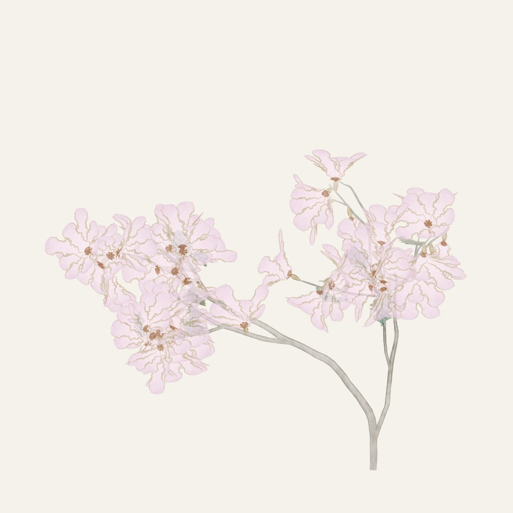
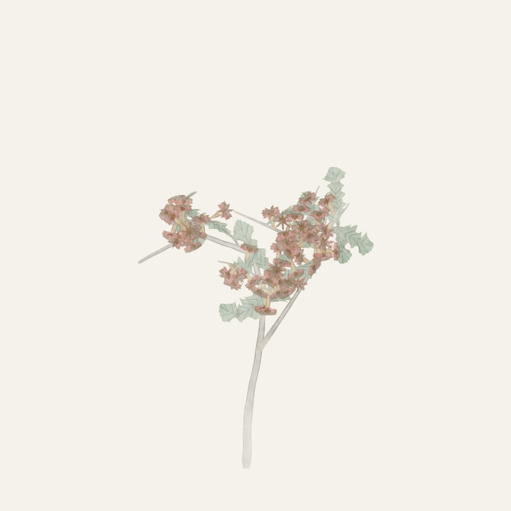

# Flowers

An adaptation of Lingdong Huang's [Nonflowers](https://github.com/LingDong-/nonflowers), retaining its seeded botanical composition and painterly raster layers.

 

These samples use `painting-stock-v1-flowers-0` and `painting-stock-v1-flowers-1`, generated through the current revision 2 worker. [Sample metadata](../../../docs/samples/manifest.json) records the image hashes.

The adapter draws in the original 600-unit coordinate system at three times the resolution, producing 1800×1800 source images. It captures transparent botanical layers separately from paper and removes the original circular mask. PNG downloads retain those native pixels; SVG wraps the raster source, and PDF embeds a rendered image.

`build.mjs` prepares the pinned upstream engine; `worker.js` loads the shared Canvas adapter and optional AssemblyScript kernels; `generate.js` adapts generation and export without modifying the upstream snapshot. The same seed and artwork revision reproduce the composition. The gallery regenerates old cached revisions before display or export.

Upstream attribution and its publication date remain beneath this adapted style on the website. The [original license](upstream/LICENSE) is retained. See the [root README](../../../README.md) for gallery controls, local development and verification.
