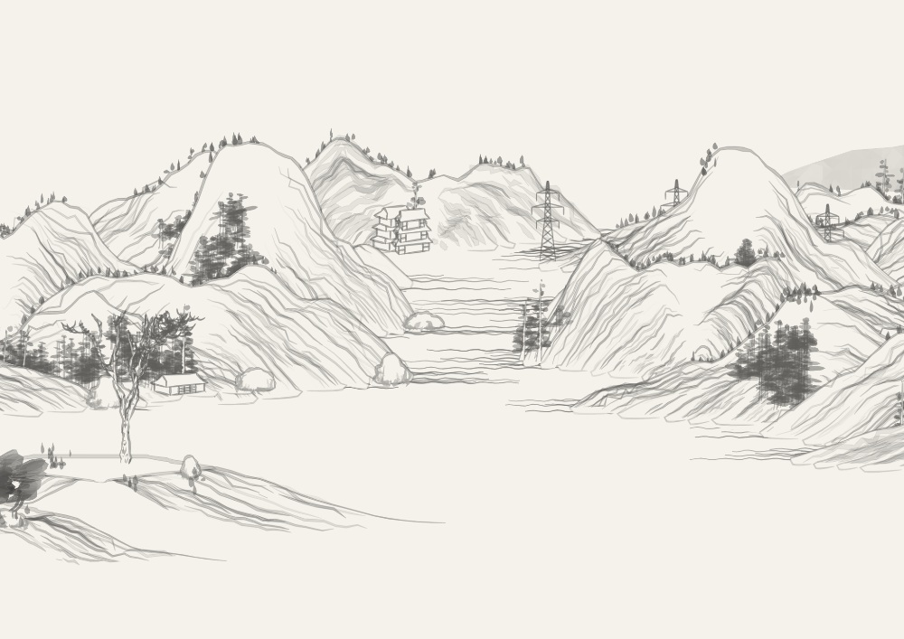
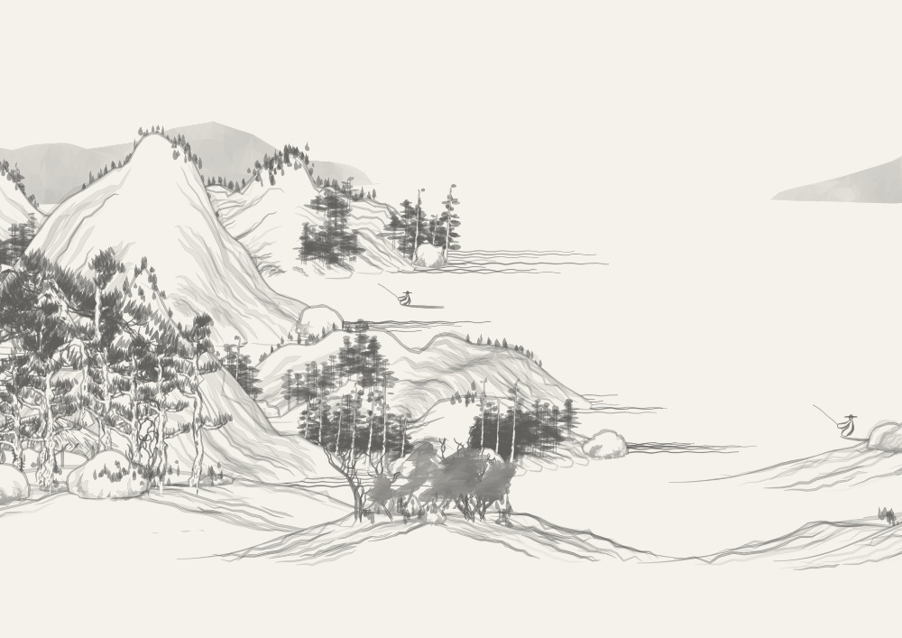
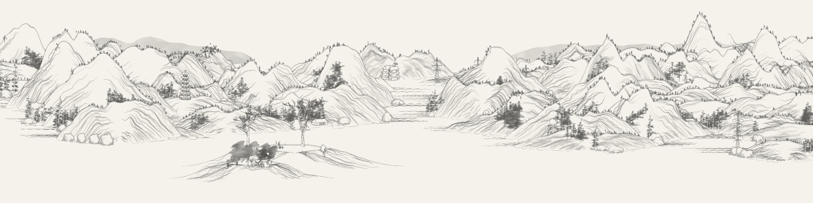

# Landscapes

An adaptation of Lingdong Huang's [Shan Shui](https://github.com/LingDong-/shan-shui-inf), producing seeded ink mountains, water, trees and small landscape details.

 

The first complete panorama:

Samples use `painting-stock-v1-landscapes-0` and `painting-stock-v1-landscapes-3`. [Sample metadata](../../../docs/samples/manifest.json) records their revision and dimensions.

The source is 3200×800. Painting metadata declares `previewWidth: 3200`, `height: 800` and `width: 800 * Math.SQRT2` for the fixed central print composition. Desktop previews retain the whole panorama for panning; phones and PNG/SVG/PDF downloads use its centered landscape crop. Panning or zooming never changes the print crop. Seascapes and Dunes now use the same display and export contract.

`preview.js` renders ordered upstream polylines through Canvas. Paper-colored faces first occlude earlier marks, then the ink conversion removes their white fill for transparency. SVG downloads retain vector geometry; PDFs currently embed raster artwork. Optional source paper texture remains available in exports.

Upstream attribution and its publication date remain beneath this adapted style on the website. The [original license](upstream/LICENSE) is retained. See the [root README](../../../README.md) for local development and the [cache guide](../../../scripts/cache/README.md) for starter asset preparation.
