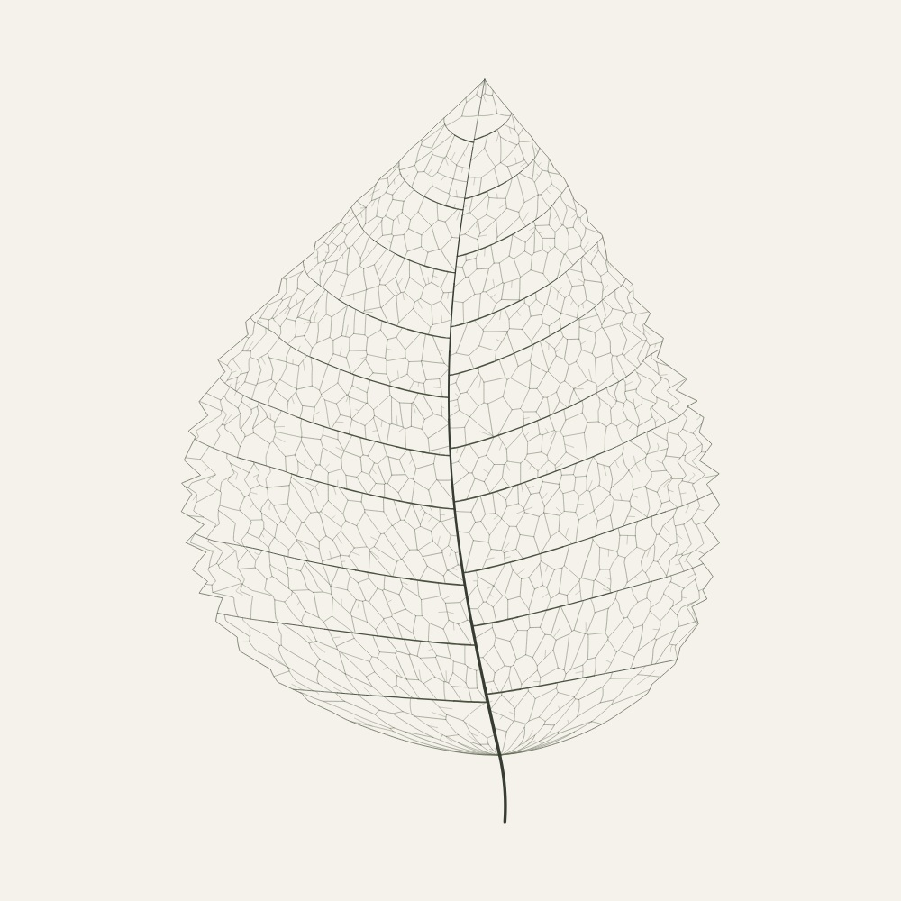
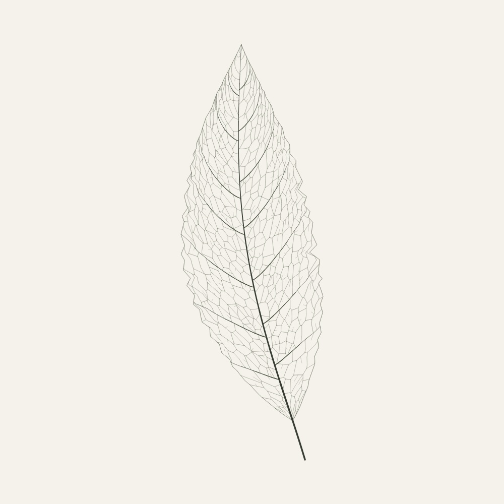

# Leaf skeletons

 

[Sample seeds and artwork revisions](../../../docs/samples/manifest.json).

An original, deterministic botanical drawing generator. Eight silhouette families
(elliptic, ovate, lanceolate, obovate, pinnately lobed, cordate, spatulate, and
falcate) vary in proportion, curvature, asymmetry, margin, secondary spacing,
and minor-vein layout. These are plausible botanical profiles, not
reconstructions of named species.

Cordate blades have rounded basal lobes around the petiole, spatulate blades
broaden above a narrow neck, and falcate blades curve into a sickle. Lobed
blades have independently varied lobe positions and depths on either side.
Serrate, dentate, and rounded crenate margins have unequal tooth spacing,
unequal depths, and occasional deeper notches. Edge deformation fades inward
to preserve the legibility of the vein cells.

The drawing has a tapered midrib and petiole, curved secondary veins, a connected
network of closed minor-vein loops (areoles), and short freely ending veinlets.
Lobed profiles direct their secondary veins toward lobe tips. An endpoint-fixed,
monotone map fills every sector from the midrib to the blade margin, including
the base and apex, without folding adjacent sectors over one another.
The ragged edge uses a monotone radial deformation; the heart-shaped base uses
a smooth vertical shear. Both preserve the vein map's orientation and
connectivity. The cordate shear saturates away from the midrib so the basal
lobes stay rounded rather than becoming pointed wings.

Minor-vein cells are bounded Voronoi polygons generated from irregular,
well-spaced sites. All adjacent polygons share edges; their network connects to
the surrounding major veins and margin. This is a compact geometric approach,
**not** a simulation of auxin transport or leaf growth.

The biological constraints are informed by:

- [Runions et al., *Modeling and visualization of leaf venation patterns* (2005)](https://algorithmicbotany.org/papers/venation.sig2005.pdf): hierarchical veins, space-filling development, and closed networks. Their growth algorithm is not reproduced here.
- [Ellis et al., *Manual of Leaf Architecture* (Smithsonian Institution, 2009)](https://repository.si.edu/server/api/core/bitstreams/9b5627fb-50bf-4c68-b887-d291c5be6bc0/content): blade profiles, pinnate major venation, reticulate minor venation, and freely ending veinlets.

No source code or illustrations are copied from these publications.

## App integration

`generateLeaf(seed)` returns self-contained SVG paths. `worker.js` runs it away
from the UI, and `build.mjs` bundles the worker without a WASM kernel. The normal
line renderer provides the preview and PNG/PDF output; SVG exports retain all
geometry. Background paper remains optional.

Generation is fast enough to run on first use, so the style sets `bundled: false`
instead of shipping a starter PNG collection. Existing browser caching preserves
the full drawing and prepared preview. Seed URLs regenerate the same geometry
for a given artwork revision. Revision 2 adds the three new families and ragged
margins; the app upgrades previously cached leaves by regenerating their seeds.

## Verification

`npm test` includes deterministic Unicode seeds, 48 distinct geometric outputs,
all eight profile families and three margin styles, measured blade anatomy,
visible edge irregularity, bounded coordinates and complexity, connected closed
vein graphs, sector coverage, shipping-worker parity, cache reloads, and vector
exports. Anatomy checks measure the actual outline and midrib, including the
spatulate blade's distal maximum width, the falcate midrib's curvature, and the
cordate blade's rounded basal lobes. The normal preparation step builds the
worker first.

For a visual audit, install the optional `canvas` package locally without saving
it to the project, then run:

```sh
npm install --no-save --package-lock=false canvas
node scripts/review-leaves.mjs /tmp/painting-art-review/leaves 48
```

Alternatively set `CANVAS_MODULE` to an existing node-canvas installation. The
audit writes the SVGs, transparent 1200-pixel PNGs, two contact sheets, detail
crops, and a JSON report with revision, timings, ink bounds, traits, and geometry hashes.
It also checks every raster against the leaf silhouette, allowing two pixels
for antialiasing and the outline stroke. Contact sheets and detail sheets also
receive JPEG copies. To refresh the PR gallery after inspecting the audit:

```sh
cp /tmp/painting-art-review/leaves/leaves-contact-{1,2}.jpg docs/previews/
cp /tmp/painting-art-review/leaves/leaves-detail-{lobed,margin,profiles}.jpg docs/previews/
```

The [48-seed gallery](../../../docs/previews/leaves-contact-1.jpg),
[second sheet](../../../docs/previews/leaves-contact-2.jpg),
[new profile comparison](../../../docs/previews/leaves-detail-profiles.jpg), and
[ragged-margin detail](../../../docs/previews/leaves-detail-margin.jpg) are review
artifacts. No generated review images are required by the production site.
