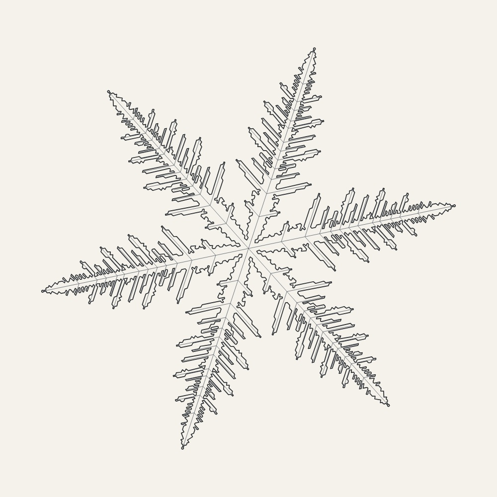
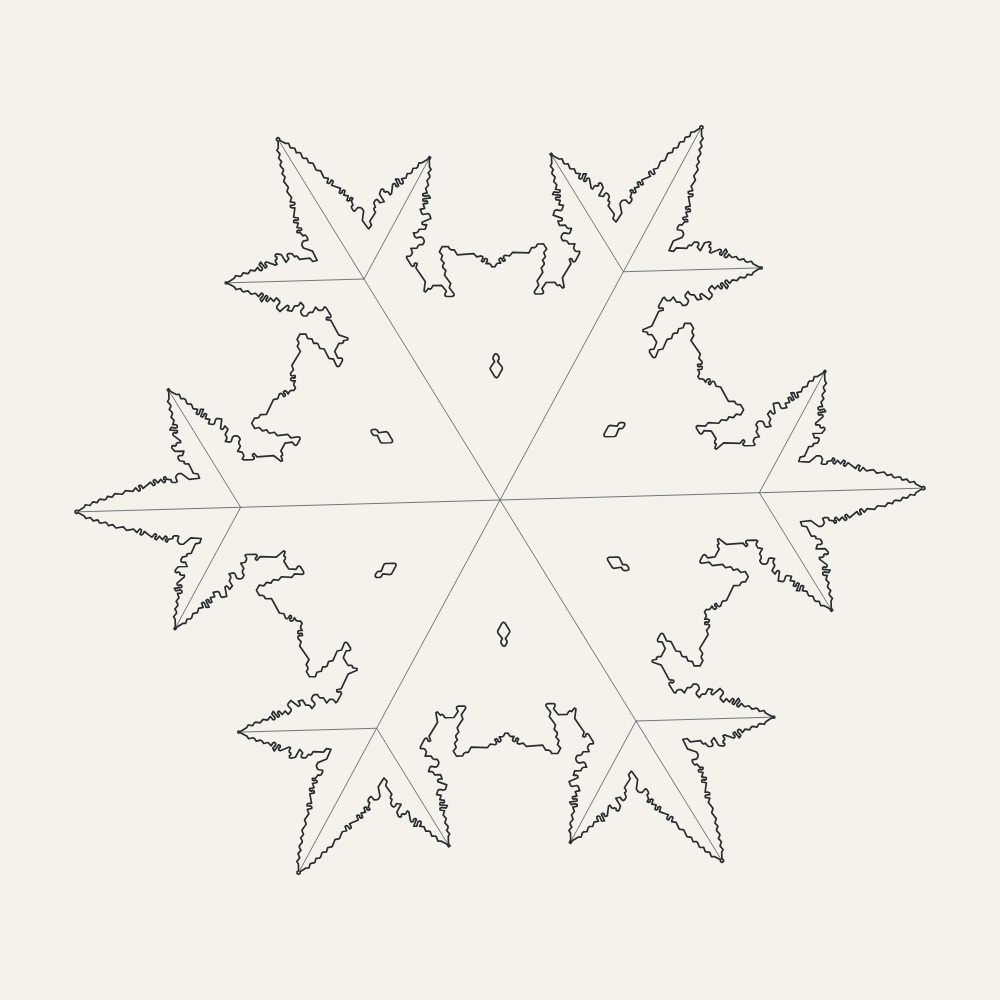
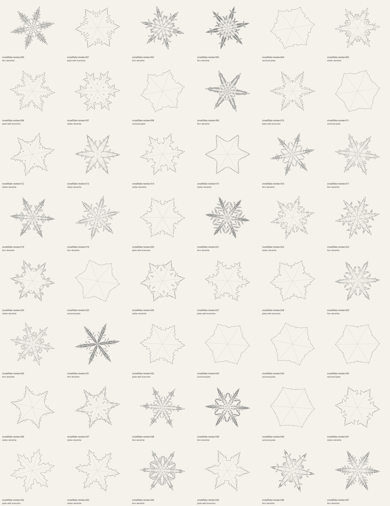

# Snow Crystal Studies

 

[Sample seeds and artwork revisions](../../../docs/samples/manifest.json).

A seeded, two-dimensional snow-crystal generator. It runs in the existing cancellable worker, returns self-contained SVG paths, and uses the gallery's normal PNG/PDF export and IndexedDB cache. It needs no WASM download or bundled starter images.

The growth rule is an original JavaScript implementation of Clifford A. Reiter's [local cellular model](https://webbox.lafayette.edu/~reiterc/mvp/sfn/sfn_pp.pdf) ([author's explanation and parameter studies](https://webbox.lafayette.edu/~reiterc/mvp/sfn/index.html)). Each hexagonal site stores a nonnegative amount of water. Ice and its neighbors retain arriving mass; mobile vapor diffuses between the other sites. Deposition and the vapor supply determine how quickly tips and side branches advance. Kenneth Libbrecht's explanations of [branching instability](https://www.snowcrystals.com/branching/branching.html) and the [morphology diagram](https://www.snowcrystals.com/morphology/morphology.html) informed the choice of coherent, shared growth histories.

One seed selects a fern, stellar, sectored-plate, or plate-with-branches regime and two changes in conditions. A circular vapor reservoir stays beyond the growing tips. The simulation evaluates one representative of each rotational/reflection orbit (up to twelve sites), which preserves sixfold symmetry exactly while keeping generation fast. Coordinates and geometry are independent of the screen size.

The ink drawing traces the frozen-cell boundary and growth ridges confined to narrow branches. A transverse-width check suppresses side ridges through broad central plates, avoiding the geometric web they previously created. Intermediate growth-boundary contours are omitted, so the hexagonal phase lines do not overlay the drawing. The changes in growth conditions still shape the final crystal. The model is qualitative: parameters are not calibrated temperatures/humidities, and columns, riming, collisions, melting, and imperfect natural symmetry are outside its scope. A finite seeded program offers extensive reproducible variation, not a mathematical guarantee of infinitely many unique crystals.

Run `node --test tests/snowflakes.test.mjs` after installing the existing dependencies. The tests cover 48 growth histories, uniqueness of both shape and drawing, sixfold symmetry, connectedness, margins, finite runtime, seed repeatability, the shipping worker, cache recovery, and SVG export.

Run `node scripts/review-snowflakes.mjs /tmp/snowflake-review 48` to write paper and transparent SVG specimens, timing/parameter metadata, and an HTML contact sheet. Open `index.html` in a browser and each SVG for full vector detail. This review command uses only Node and the generator; raster screenshots are optional.

The November 2026 local review covered 48 specimens across all four regimes, plus 32 slow or dense cases selected from 2,000 parameter candidates. All completed. The 48 drawings and frozen-cell shapes were distinct and connected, and their simplified outlines retained sixfold symmetry without self-crossings. Ordinary samples took 0.7–2.6 seconds; the selected stress cases took at most 4.1 seconds on the review machine. Stress output stayed below 65 KB of SVG; the Node process peaked at about 91 MiB RSS. These are local measurements, not device-independent latency promises.

## Revision 2 visual review

The current 48-seed audit covers all four habits, with 48 distinct SVGs and 48 distinct raster images. No drawing touches the raster edge. Growth history, connectedness and sixfold outlines remain unchanged; only the phase overlays and broad-plate ridge marks are removed.

[Current measurements and seeds](../../../docs/previews/snowflakes-report.json). Reproduce with `node scripts/art-review/snowflakes.mjs --count 48 --raster --out .artifacts/snowflakes`; install the optional Canvas/Path2D dependencies described in the root README. The earlier timing and stress figures above describe the original growth-model review.
